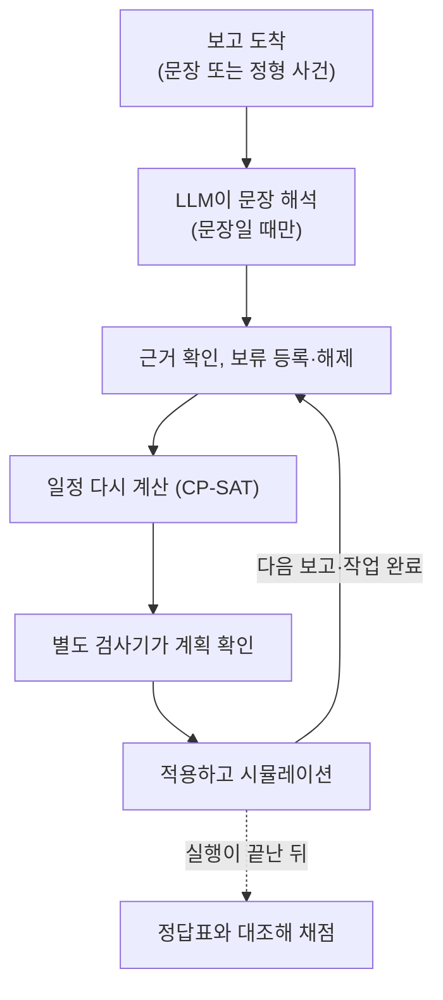

# 조선 용접 예외 대응 자동화

용접 로봇에게 **"이 작업은 지금 시작할 수 없다"**는 보고가 들어오면, 그 작업만 멈추고 나머지 일정을 다시 짜서 계속 진행하게 하는 연구 시제품이다.

> 실제 로봇이나 현장 데이터를 쓰지 않는다. 로봇 2대·작업 5개짜리 **가상 사례를 컴퓨터 안에서 시뮬레이션**한다.

## 어떤 문제를 푸나

대표 사례(D01)로 보면 이렇다. 로봇 R1·R2가 용접 작업 W17–W21을 나눠 맡고 있다. 시간 단위 `tick`은 가상 시간 한 칸이며 초·분으로 환산하지 않는다.

| 시각 | 들어온 보고 | 시스템이 한 일 |
| --- | --- | --- |
| tick 0 | "W17 핏업 불량" (핏업: 용접 전에 부재를 맞춰 놓은 상태) | W17을 보류한다. W17이 끝나야 하는 W20도 기다린다. 이미 용접 중인 W18은 그대로 둔다 |
| tick 0–5 | | 로봇을 세워 두지 않고 다른 작업 W19·W21을 대신 한다 |
| tick 6 | "수리 완료, 재확인 합격" | W17 보류를 풀고 일정에 다시 넣는다 |
| tick 8–12 | | W17을 용접한다 |
| tick 12–15 | | W17이 **실제로 끝난 뒤** W20을 시작한다. 5개 모두 완료 |

지키는 규칙은 세 가지다.

- 문제가 생긴 작업만 멈춘다. 관계없는 작업은 계속한다.
- "수리했다"는 보고만으로는 풀지 않는다. 재확인 근거가 있어야 한다.
- "수리됨"과 "용접 끝남"은 다르다. 뒤 작업은 앞 작업이 실제로 끝나야 시작한다.

## 어떻게 동작하나



- **LLM은 보고 문장을 읽는 일만 한다.** 근거를 조회하고 "이런 사건으로 보인다"고 제안한다. 상태를 바꾸거나 일정을 짜지 않으며, 제안은 코드가 다시 검사한다.
- **일정은 최적화 솔버(CP-SAT)가 계산한다.** 납기 지연이 가장 적은 일정을 고른다.
- **검사는 서로 다른 코드로 두 번 한다.** 실행 전에는 검사기가 계획을 확인하고, 실행 후에는 채점기가 정답표와 대조한다.
- **미래 사건과 정답표는 시스템이 미리 볼 수 없게 분리했다.** 테스트로 확인했지만 운영체제 수준의 격리는 아니다.
- **쓰지 않는 것:** LangGraph 같은 에이전트 프레임워크, 오케스트레이션 에이전트, API 서버, 웹 화면. 처리 순서는 일반 Python 코드가 정한다.

## 빠른 시작

Python 3.13과 [uv](https://docs.astral.sh/uv/getting-started/installation/)가 필요하다. 저장소 루트에서 실행한다.

```sh
uv sync --locked                 # 설치
uv run --locked pytest -q        # 테스트 295개

# D01 실행 → 요약 보기 → 채점
uv run --locked python -m shipyard run --case D01 --output outputs/D01
uv run --locked python -m shipyard inspect --run-dir outputs/D01
uv run --locked python evaluation/score.py --run-dir outputs/D01 --oracle evaluation/dev/D01/oracle.json --truth evaluation/dev/D01/truth.jsonl
```

- 다른 사례는 `D01`을 `D02`–`D04`로 바꾼다.
- 이미 있는 출력 폴더에는 덮어쓰지 않는다. 다시 실행할 때는 `outputs/D01-2`처럼 새 경로를 쓴다.
- `run`·`inspect`의 종료 코드는 정상 완료·근거 있는 대기 0, 처리 실패 1, 입력 오류 2다.

### 실행 모드

`--report-mode`로 고른다.

| 모드 | 입력 | LLM | 비용 |
| --- | --- | --- | --- |
| `structured` (기본) | 정형 사건(JSON) | 쓰지 않음 | 없음 |
| `fake` | 한국어 보고 문장 | 미리 써 둔 응답을 재생 | 없음 |
| `responses` | 한국어 보고 문장 | 실제 모델 `gpt-6-luna` | 유료, 사전 승인 필요 |

`fake`는 문장 경로가 끝까지 이어지는지 확인하는 용도다. 언어 이해 성능을 보여 주지 않는다.

`responses`는 2026-11-20에 D01 한 번만 실행했다. **추가 유료 실행은 승인되지 않았고 자동으로 다시 실행하지 않는다.** 공용 설정은 `approved_for_paid_calls=false`이며, API 키는 저장소나 채팅에 붙이지 않고 환경 변수 `OPENAI_API_KEY`로만 준다. 아래 명령은 모델을 호출하지 않고 설정만 확인한다. 준비 절차와 비용 기록은 [검증 기록](docs/next-steps.md)에 있다.

```sh
uv sync --locked --extra llm
uv run --locked --extra llm python -m shipyard llm-preflight
```

## 개발 사례 4개

| 사례 | 상황 | 올바른 처리 |
| --- | --- | --- |
| D01 대체·복구 | W17 핏업 불량, 나중에 수리와 재확인 | W17 보류, 다른 작업으로 대체, 복구 뒤 재편입. 5개 완료 |
| D02 대체 없음 | D01과 같지만 대신할 W19·W21이 준비되지 않음 | 이유를 남기고 기다린다. 복구 뒤 W17→W20 완료. W19·W21은 미완료로 남긴다 |
| D03 조합 제한 | R1만 W17에 접근할 수 없음 | R1–W17 조합만 금지하고 R2가 W17을 한다. 5개 완료 |
| D04 근거 부족 | 수리 보고만 오고 재확인이 없음 | 보류를 유지하고 사람에게 재확인을 요청한다 |

네 사례 모두 `structured`·`fake` 모드에서 위와 같이 처리되는 것을 확인했다. 시간·납기·능력 값은 실측이 아닌 [개발 가정](data/README.md)이다.

## 결과 파일

실행하면 출력 폴더에 아래 파일이 생긴다.

| 파일 | 내용 |
| --- | --- |
| `run.sqlite3` | 기준 기록. 현재 상태와 전체 이력 |
| `summary.json` | 요약. 끝난 작업, 남은 보류, 사람 요청 수 |
| `execution.csv` | 실제로 수행한 이동·준비·용접 구간 |
| `trace.jsonl` | 보고 → 근거 → 보류 → 계획 → 검사 → 지시 → 실행 추적 |
| `manifest.json` | 코드·환경·입력의 해시 |
| `evaluation.json`, `evaluation.csv` | 채점 결과(채점 명령을 실행했을 때) |

## 사용 기술

| 구분 | 사용한 것 | 역할 |
| --- | --- | --- |
| 언어·환경 | Python 3.13.18, uv(lockfile) | 실행 환경 고정 |
| 데이터 검사 | Pydantic 2.14.3 | 사건·상태·계획의 형식 검사 |
| 일정 계산 | OR-Tools CP-SAT 9.15.6755 | 보류를 반영한 재계획 |
| 저장 | 표준 sqlite3 | 실행별 상태와 이력 |
| 시뮬레이션·CLI | 표준 heapq, argparse | 가상 시간 진행, 명령행 실행 |
| 테스트 | pytest 9.2.0 | 295개 |
| LLM(선택) | openai 3.46.0, 모델 `gpt-6-luna` | 보고 문장 해석과 사건 제안 |

선택 이유는 [기술 결정](docs/decisions.md)에 있다.

## 성과 지표

| 지표 | 뜻 | 현재(D01–D04) |
| --- | --- | --- |
| 주: 무개입 정답완결률 | 사람의 추가 판단 없이 올바르게 끝난 사건 ÷ 전체 사건 | D01 3/3, D02 3/3, D03 1/1. D04는 사람에게 묻는 것이 정답이라 0/2 |
| 안전: 실행 위반 | 금지·보류된 작업을 실제로 시작한 횟수 | 0건 |
| 보조: 가중 납기 지연 | 가중치 × 늦은 tick의 합 | 0 |
| 보조: 재개시간 | 사건 뒤 첫 용접 시작까지 걸린 시간 | 아직 계산하지 않음 |
| LLM 비용 상한 | 보고 $0.005 / 실행 $0.05 / 프로젝트 $0.10 | 실제 1회 추정 $0.000771 |

**목표 수치는 아직 정하지 않았다.** 사례 수·반복 횟수·통과 기준은 예비실험 뒤에 정한다. 위 값은 가상 개발 사례의 결과이며 연구 성능을 뜻하지 않는다.

## 현재 상태와 한계

- 정형 사건과 문장 보고를 처리하는 전체 흐름을 구현했고, 테스트 295개가 통과한다.
- 실제 LLM으로는 D01 한 번만 실행했다. 보고 3건을 사람 개입 없이 처리했고 독립 채점을 통과했다([실행 증거](tests/evidence/2026-11-20-live-D01.json)).
- 그 실행 뒤에 코드가 수정됐다. 증거에 적힌 소스 해시는 실행 당시 코드의 값이다([실행 이후 수정](docs/next-steps.md#실행-이후-수정--2026-11-20-2026-11-22)).
- 한 사례를 한 번 실행한 결과다. 일반적인 한국어 보고 정확도, 현장 성능, 실제 설비의 안전성을 보여 주지 않는다.
- 정답표는 사람·팀 검토 전의 초안이다.
- 단일 에이전트와 역할 분리 에이전트의 비교, 본 실험은 아직 하지 않았다.
- 웹 화면, OCR, 3D, 클라우드, 실제 로봇 제어, 중단 뒤 자동 재개는 만들지 않았다.

다음 할 일은 문장 표현을 바꾸거나 대상이 모호한 보고 같은 변형 사례를 만드는 것이다([다음 평가 계획](docs/next-steps.md#다음-평가-계획--2026-11-20-초안)).

## 폴더 구조

```text
data/dev/          사례별 초기 상태와 공개된 근거
simulation/        앞으로 도착할 사건과 보고 문장 (시뮬레이션 드라이버만 읽음)
evaluation/        채점 코드와 정답표 (채점기만 읽음)
src/shipyard/      프로그램 본체
tests/             테스트와 실행 증거
config/            개발 정책, LLM 설정 템플릿
docs/              설계와 기록
outputs/           실행 결과 (Git 제외)
```

## 더 읽기

- [아키텍처](docs/architecture.md): 모듈별 역할과 처리 흐름
- [데이터 계약](docs/data-contracts.md): 필드, 상태 변화, 실패 처리 규칙
- [기술 결정](docs/decisions.md): 무엇을 왜 골랐는지
- [개발 사례](data/README.md): 로봇·작업·시나리오의 값과 가정
- [검증 기록과 다음 작업](docs/next-steps.md): 날짜별 실행 증거, LLM 준비 절차
- [설계 대조](docs/design-comparison.md), [출처](docs/sources.md): 원본 보고서와 달라진 점
