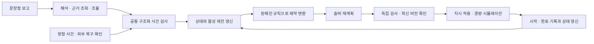

# 조선 용접 예외 대응 자동화

용접을 시작할 수 없다는 보고를 작업 정보와 연결하고, 근거에 따라 **보류·계속·대체·대기·복구 후 재편입** 지시를 만드는 연구 프로젝트다. 정의한 사건을 사람의 추가 판단 없이 올바르게 처리할 수 있는지 경량 시뮬레이션으로 검증한다. 생산 지연과 작업 재개시간은 보조 운영 지표다.

**현재 단계: 최소 구현용 기술 선택·아키텍처·데이터 계약 작성 완료 / 기능 구현 전.** 기준은 2026-11-06 프로젝트 기준 문서 v1.0이다. 원본 중간보고서는 초기 설계와 근거 이력으로 사용한다. 충돌하는 설계는 최신 기준 문서를 따른다.

## 현재 상태

| 구분 | 상태 |
| --- | --- |
| 문제·범위·평가 원칙 | 두 문서에서 정리한 설계 기준 |
| README·설계 대조표·기술 결정·아키텍처·데이터 계약·다음 작업 | 문서 작성 완료. DEC-01~06 개발 기본안 채택 |
| 개발용 2대·5개 사례 | 문서의 수치·규칙을 개발 가정으로 채택. 실행 데이터·독립 정답표는 아직 없음 |
| 선택 검증용 작은 실행 | 로컬 Python/CP-SAT/Pydantic/SQLite API 예제 확인. 앱 통합 검증과 구별 |
| 사건 검사·상태 저장·제약 변환·솔버·독립 실행 검사기·시뮬레이터·로그 | **미구현** |
| 단일/역할 분리 에이전트, 자동 평가 | **미구현** |
| 실행·통합 테스트·비교실험·성능 결과 | **미실행 / 결과 없음** |

패키지·CLI·파일 배치는 설계했지만 `pyproject.toml`, `uv.lock`, 실행 코드와 데이터는 아직 없다. [아키텍처의 명령](docs/architecture.md)은 다음 구현의 인터페이스이며 현재 실행 가능한 사용법이 아니다. 문서와 작은 API 예제의 성공은 기능 구현이나 연구 가설 검증을 뜻하지 않는다.

## 범위와 지켜야 할 원칙

- 첫 구현은 용접 **시작 전** 작업 불가와 시작된 작업을 침해하지 않는 자원 상태 변화다. 이미 시작된 작업은 유지한다.
- 부재 핏업 문제인 W17은 다른 로봇으로 옮겨도 수행할 수 없다. W20은 선행 작업 W17의 **실제 완료 후**에만 시작할 수 있다.
- R1–W17 조합 불가는 그 조합만 제한한다. W17 전체 보류나 R1 전체 고장으로 확대하지 않는다.
- 부재 검사·보수·재확인 신호는 외부 환경 입력이다. 물리적 수리, 용접 도중 중단·부분 완료·재작업 판정, 실제 설비 제어는 제외한다.
- 근거·제약·상태 최신성·정해진 운영 정책을 통과한 계획만 자동 적용한다. 근거 부족이나 물리 제약을 목적함수 또는 임의 승인으로 해제하지 않는다.
- 조회로 보완할 수 있는 정보는 자동 조회한다. 현물 재확인처럼 새 판단이 필요하면 이유와 미확인 항목을 기록하고 요청한다. 일괄 정지나 모든 사건의 사람 이관은 자동화 성공이 아니다.

## 계획된 처리 흐름

아래는 구현할 구조이며 현재 실행되는 기능이 아니다.



에이전트는 해석과 조회를 맡고 상태를 직접 수정하지 않는다. 임의 수식·실행 코드를 솔버에 전달하지 않는다. 정형 사건은 LLM 없이 공통 검사 경로로 들어간다. 대체가 불가능하면 근거 있는 대기를 기록하고, 확인된 복구 후 다시 계획에 편입한다.

## 채택한 기술과 남은 결정

| 역할 | 최소 구현의 선택 | 이유 |
| --- | --- | --- |
| 언어·환경 | CPython 3.13.18 + uv 0.13.7 | 솔버·상태·시뮬레이션·평가를 한 언어로 구현하고 lockfile로 팀 환경 고정 |
| 입력 계약 | JSON/JSONL + Pydantic 2.14.3 | 사건·근거·계획의 타입과 미정의 필드를 경계에서 검사 |
| 기준 저장 | SQLite + 표준 sqlite3 | 별도 서버 없이 상태·제한·지시·로그를 원자적으로 갱신 |
| 재계획 | OR-Tools CP-SAT 9.15.6755 | 원본 구간 일정 설계 재사용, 팀원별 라이선스 준비 없이 재현 |
| 시뮬레이션 | 표준 heapq | 사건 순서·가상 시간·취소된 지시를 작은 코드로 명시 |
| 테스트·실행 | pytest 9.2.0, argparse CLI | 오류 주입·임시 DB 검증과 한 명령 실행. DB에서 JSONL/CSV/요약 출력 |

Gurobi 경험은 변수·제약·목적·해 상태 해석에 활용한다. 기능이 부족해서 제외한 것이 아니며 학생 라이선스를 팀/클라우드에서 공유 가능하다고 가정하지 않았다. 후보 비교·공식 문서·실제 확인 결과·학습 순서는 [DEC-01~09](docs/decisions.md)에 있다.

개발 정책은 근거·제약·최신성을 통과한 실행 가능 해를 자동 적용하고, 해 없음·시간 내 해 미발견·최적성 미증명·근거 부족을 구별한다. W17 복구는 해당 제한의 해제일 뿐 작업 완료가 아니다. W20은 W17의 실제 완료 후에만 착수한다.

후속 보고 처리는 공식 SDK와 구조화 출력의 얇은 어댑터를 추천한다. 모델·호출 예산은 후속 연결에서 결정하고, 본 평가 규모·반복·수치 통과 기준은 예비실험 후 고정한다. API 서버·웹 UI·agent framework·OCR·3D·클라우드는 현재 필수 구성에 포함하지 않는다.

## 평가 원칙

주 비교는 **단일 에이전트 + 솔버**와 **역할을 나눈 에이전트 + 같은 솔버**다. 같은 모델·자료·규칙·검사기·호출/토큰 상한을 쓰며 단일 구조에도 조회와 자기 검토를 허용한다. 역할 분리의 우수성을 전제하지 않는다. 납기 우선 규칙과 솔버 비교는 보조 실험이며 LLM 직접 일정 작성은 필수 비교군에서 제외한다.

주 지표는 전체 평가 사건 중 추가 사람 판단·승인 없이 제한시간 내 정답 행동을 완료한 **무개입 정답완결률**이다. 실행·대체·근거 있는 대기를 구분한다. 필요한 확인 요청이 올바르더라도 사람 응답이 있어야 종결되면 무개입 완결에 포함하지 않는다. 사전에 정한 외부 검사·보수·복구 입력과 시스템이 추가로 요청하는 사람 개입은 별도로 기록한다.

잘못된 지시의 제안·차단·실행, 보류 누락·과잉, 복구 후 재편입 누락, 처리시간·모델 비용을 함께 기록한다. 개발용/평가용 사례와 시스템/평가자 정보를 분리한다. 정답표·평가자 실제 상태·미래 사건 및 복구 시각은 시스템 입력에 넣지 않는다. 본 평가 결과와 실제 설비 안전성은 아직 주장할 수 없다.

## 저장소 구조와 읽는 순서

```text
.
├── README.md
├── .gitignore
├── docs/
│   ├── sources.md              # 사용한 두 문서와 근거·가정 구분
│   ├── design-comparison.md    # 유지·변경·미결정 설계 대조
│   ├── decisions.md            # 채택 기술·비교 근거·학습 안내
│   ├── architecture.md         # 모듈·권한·의존관계·예정 파일
│   ├── data-contracts.md       # 필드·상태 전이·버전·실패 처리
│   └── next-steps.md           # 작업 의존관계와 완료 기준
├── data/
│   └── README.md               # 2대·5개 개발 가정, 공개/비공개 입력 배치
├── src/
│   └── README.md               # 선택한 패키지와 구현 경계 안내
├── tests/
│   └── README.md               # 개발 검증 계획, 아직 테스트 코드 없음
└── evaluation/
    └── README.md               # 독립 채점과 정보 분리 원칙, 아직 평가 코드 없음
```

[설계 대조](docs/design-comparison.md) → [기술 결정과 학습 안내](docs/decisions.md) → [아키텍처](docs/architecture.md) → [데이터 계약](docs/data-contracts.md) → [개발 사례](data/README.md) → [다음 작업](docs/next-steps.md) 순서로 읽는다.

다음 작업은 **I01~I09로 로봇 2대·작업 5개의 정형 사건 전체 흐름을 구현하고 M01~M10의 실제 증거를 남기는 것**이다. 바로 사용할 구현 요청문은 [다음 작업 문서](docs/next-steps.md)에 있다. 이번 변경은 설계와 문서 정비 및 선택 확인용 작은 실행까지이며, 앱 구현·본 비교실험·LLM 호출은 하지 않았다.
