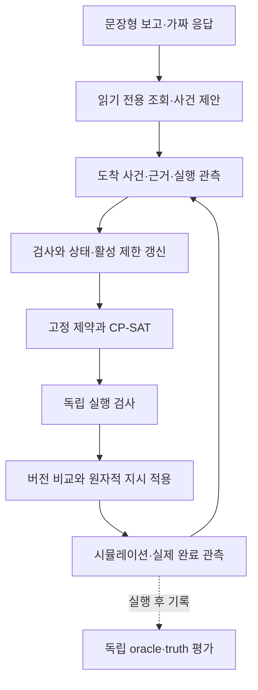

# 조선 용접 예외 대응 자동화

용접 시작 불가 보고를 공개 근거와 연결해 **보류·대체·대기·복구 후 재편입**을 자동 처리하는 연구 시제품이다. 정형 사건 → 근거 확인 → 상태·제한 갱신 → 고정 제약 → CP-SAT → 독립 실행 검사 → 원자적 적용 → 시뮬레이션 → 독립 사후 평가를 연결했다.

**현재 상태: 정형 사건 I01–I09와 가짜 모델 문장형 보고 어댑터 구현.** 기존 117개를 유지한 전체 186개 테스트가 통과했다. D01–D04 개발 사례와 M01–M10 검증 증거는 [다음 작업·검증 기록](docs/next-steps.md)에 있다. 실제 LLM 연결·에이전트 비교와 본 비교실험은 아직 하지 않았다. 개발 사례의 통과는 현장 성능이나 실제 설비 안전성을 입증하지 않는다.

## 실행

Python 3.13.18과 uv 0.13.7을 사용했다. [uv 설치 안내](https://docs.astral.sh/uv/getting-started/installation/)에 따라 uv를 준비하고 저장소 루트에서 실행한다.

```sh
uv sync --locked
uv run --locked pytest -q
uv run --locked python -m shipyard run --case D01 --output outputs/D01
uv run --locked python -m shipyard inspect --run-dir outputs/D01
uv run --locked python -m shipyard run --case D01 --report-mode fake --output outputs/reports-D01
uv run --locked python evaluation/score.py --run-dir outputs/D01 --oracle evaluation/dev/D01/oracle.json --truth evaluation/dev/D01/truth.jsonl
```

출력 경로가 이미 있으면 덮어쓰지 않고 종료한다. 재실행은 `outputs/D01-2`처럼 새 경로를 사용한다. `--case D02`, `D03`, `D04`도 같은 명령을 사용하며 평가 자료 경로도 해당 사례로 바꾼다. `run`/`inspect` 종료 코드는 정상 완료·근거 있는 대기 0, 처리 실패 1, 입력·실행 오류 2다. 평가 명령은 정답 행동 충족 여부를 별도로 반환한다.

| 개발 사례 | 실제 확인한 처리 |
| --- | --- |
| D01 대체·복구 | W17 전체 보류, W20 차단, W18 유지. 대체 실행 뒤 조치+재확인으로 W17 재편입, 5개 작업 완료 |
| D02 대체 없음 | R1에 이유·재검토 조건을 갖춘 대기. 복구 후 W17→W20 완료. 미준비 W19·W21은 미완료로 남음 |
| D03 조합 제한 | R1–W17만 금지하고 R2로 W17 수행. 5개 작업 완료 |
| D04 재확인 부족 | 수리 보고만으로 해제하지 않음. W17·W20 보류, 재확인 요청 1건. 올바른 요청이지만 무개입 완결에 포함하지 않음 |

시간·능력·납기·복구 입력은 [개발 가정](data/README.md)이며 초/분으로 환산하지 않는 추상 tick이다. W17의 **복구와 실제 완료는 서로 다른 사실**이다. W20은 이동·준비·용접 각 착수 때 W17의 실제 완료를 다시 확인한다.

`--report-mode fake`는 한국어 보고와 미리 작성한 응답으로 **보고 → 현재 근거 조회 → 사건 제안 → 기존 공통 처리**를 실행한다. 실제 LLM이나 API 키는 필요 없다. 잘못된 JSON·근거 위조·모델 오류는 대상별 확인 대기/식별 요청으로 처리하며, 보고 중복은 모델과 재계획을 반복하지 않는다. 독립 채점에는 같은 평가 명령의 `--run-dir`을 `outputs/reports-D01`로 바꾼다. 가짜 응답 통과는 언어 이해 성능의 증거가 아니다.

## 결과 확인

각 실행의 `run.sqlite3`가 기준 기록이다. `manifest.json`은 코드·환경·정책·입력 해시, `trace.jsonl`은 보고 해석의 요청·응답·조회·실패와 사건/근거/제한/계획/검사/지시/관측 추적, `execution.csv`는 실제 완료 phase, `summary.json`은 운영 결과와 보고 수·변환 상태·모델 호출/조회 횟수다. 별도 평가 명령은 독립 oracle·truth와 실제 기록을 대조하여 `evaluation.json`, `evaluation.csv`를 만든다. 검사기의 PASS나 운영 요약을 정답으로 복사하지 않는다.

미래 사건은 시뮬레이터 큐에만 저장하고 도착 시점에 공개한다. 공개 입력 로더의 파일 접근, DTO의 추가 필드 거부, 모듈 의존관계, 미래·정답 sentinel 유입을 테스트했다. 이것은 단일 프로세스의 데이터 흐름 경계이며 악의적인 Python 코드에 대한 OS 격리는 아니다.

## 구조와 기술

```text
config/                   개발 정책
data/dev/D01–D04/        현재 공개 초기 상태·근거
simulation/dev/D01–D04/   드라이버 전용 미래 외부 입력
simulation/reports/      드라이버 전용 문장·가짜 응답 대본
src/shipyard/             사건·저장·제약·솔버·검사·조율·시뮬레이션·CLI
tests/                   단위·경쟁 상태·오류 주입·통합·정보 경계 검증
evaluation/              독립 평가 코드와 개발 oracle/truth
docs/                    설계 근거·결정·계약·검증 기록
outputs/                 실행 생성물(Git 제외)
```

CPython 3.13.18, uv lockfile, Pydantic 2.14.3, OR-Tools CP-SAT 9.15.6755, 표준 SQLite·heapq·argparse, pytest 9.2.0을 사용한다. 별도 API 서버·ORM·에이전트 프레임워크는 없다. Gurobi와의 비교 및 학습 안내는 [DEC-01–09](docs/decisions.md)에 있다.



## 연구 범위와 다음 단계

원본의 문제 정의·R1/R2·W17/W20 선행관계·CP-SAT·독립 검사 구조를 유지했다. 사용자 최신 지시와 프로젝트 기준 문서 v1.0을 우선하며, 원본과의 변경 이유는 [설계 대조](docs/design-comparison.md)와 [출처](docs/sources.md)에 기록한다.

주 성과는 추가 사람 판단 없이 사건을 올바르게 종결하는 **무개입 정답완결**이고 생산 지연은 보조 지표다. 후속 단일 에이전트와 역할 분리 에이전트는 같은 솔버와 공통 처리 경로를 사용하며 역할 분리의 우수성을 전제하지 않는다. 모델·예산·본 평가 규모·반복·수치 통과 기준은 후속 단계/예비실험 이후 결정한다.

다음 단계는 어댑터 뒤에 실제 LLM을 연결하기 전 모델 권한·토큰/금액/시간 예산·보고 외부 전송 정책을 정하는 것이다. [DEC-07](docs/decisions.md)에 공식 자료에서 확인한 후보와 미결정 사항을 정리했다. 유료 LLM 호출·웹 UI·OCR·3D·클라우드·실제 로봇 제어·물리적 수리는 이번 구현에 포함하지 않았다. 프로세스 crash 후 자동 재개도 구현하지 않았으며 기존 출력을 보존하고 새 실행으로 시작한다.

[기술 결정·학습](docs/decisions.md) → [아키텍처](docs/architecture.md) → [데이터 계약](docs/data-contracts.md) → [개발 사례](data/README.md) → [검증 증거·다음 작업](docs/next-steps.md).
