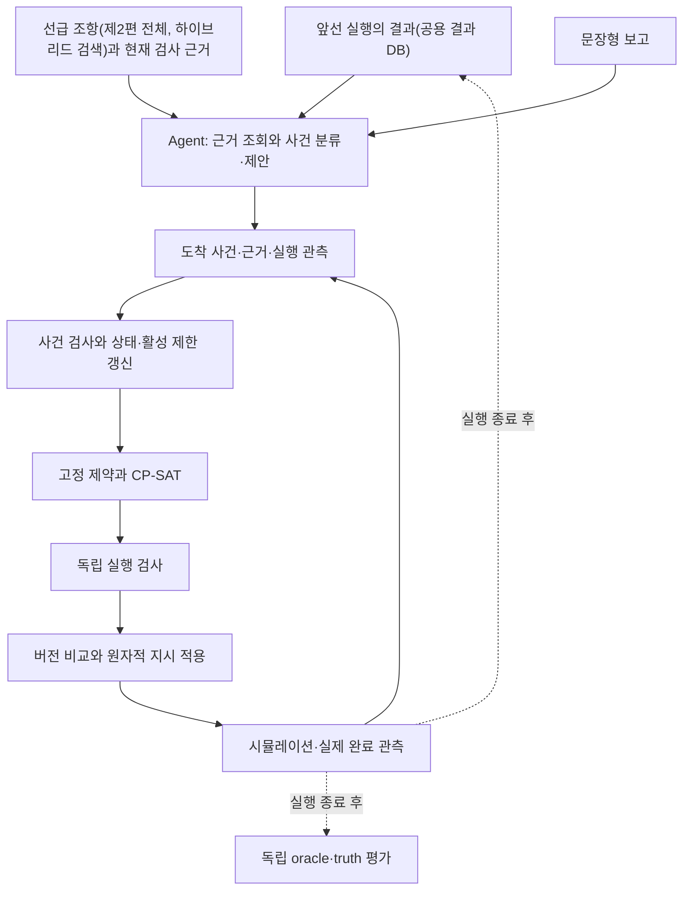

# 조선 용접 예외 대응 자동화

용접 시작 불가 보고를 공개 근거와 연결해 **보류·대체·대기·복구 후 재편입**을 자동 처리하는 연구 시제품이다.

```text
문장형 리포트 → Agent(GPT)가 근거를 조회하고 사건을 분류·제안
             → 결정적 사건 검사(보류 걸기·풀기) → CP-SAT 재계획 → 독립 실행 검사 → 적용
             → 시뮬레이션 → 실행이 끝나면 리포트별 결과를 공용 결과 DB에 기록
             → 다음 실행의 Agent가 앞선 결과를 유사 사례로 참고
```

**Agent는 분류만 한다.** 리포트를 어떤 근거로 확인하고 어떤 사건(`FITUP_FAILED`, `REPAIR_REPORTED` 등)으로 볼지 제안한다. 보류·해제·배정은 사건 검사와 solver가 결정한다. 구역 점유·로봇 위치 같은 현재 상태 판단도 과거 사례가 아니라 solver가 현재 DB 상태로 한다.

**현재 상태.** D01–D04 기본 사례와 같은 형식의 추가 사례를 정형·fake·실제 API(Responses) 모드로 실행할 수 있다. 2026-11-23 D04를 실제 API로 실행해 독립 채점을 통과했다. [개발 검증 기록](docs/next-steps.md)

## 준비

Python 3.13.18과 uv 0.13.7을 사용했다. [uv 설치 안내](https://docs.astral.sh/uv/getting-started/installation/)에 따라 uv를 준비하고 저장소 루트에서 실행한다.

```cmd
cd /d C:\github\shipyard-welding-automation
set UV_LINK_MODE=copy
set PYTHONUTF8=1
uv sync --locked
```

Windows에서 uv 캐시와 저장소가 다른 드라이브·클라우드 폴더에 있으면 하드링크 설치가 실패한다. `UV_LINK_MODE=copy`로 복사 설치한다. `PYTHONUTF8=1`은 cp949 콘솔에서 한글 JSON을 읽을 때의 인코딩 오류를 막는다. PowerShell에서는 `$env:UV_LINK_MODE='copy'`, `$env:PYTHONUTF8='1'`로 설정한다.

## 1. API 없이 실행 (무료)

```cmd
uv run --locked python -m shipyard run --case D01 --output outputs\D01
uv run --locked python -m shipyard run --case D01 --report-mode fake --output outputs\D01-fake
uv run --locked python -m shipyard inspect --run-dir outputs\D01
uv run --locked python evaluation\score.py --run-dir outputs\D01 --oracle evaluation\dev\D01\oracle.json --truth evaluation\dev\D01\truth.jsonl
```

| 모드 | 리포트 처리 | 용도 |
| --- | --- | --- |
| `structured`(기본) | 리포트 없이 정형 사건을 바로 처리. LLM 없음 | 사건 검사·solver 흐름 확인 |
| `fake` | 리포트 본문 + `simulation/reports/<사례>.jsonl`의 미리 쓴 GPT 응답 대본 | Agent 경계·검증기 확인. 언어 이해 성능의 증거는 아님 |
| `responses` | 리포트 본문을 실제 GPT에 보냄 | 아래 2절 |

`--case D02`, `D03`, `D04`도 같은 명령이며 평가 자료 경로도 해당 사례로 바꾼다. 출력 경로가 이미 있으면 덮어쓰지 않고 종료하므로 재실행은 `outputs\D01-2`처럼 새 경로를 쓴다. `run`/`inspect` 종료 코드는 정상 완료·근거 있는 대기 0, 처리 실패 1, 입력·실행 오류 2다.

fake 실행에 `--rules`와 `--history`를 주면 선급 조항 조회를 켜고, 실행이 끝난 뒤 결과를 공용 결과 DB에 기록한다. fake 모드는 결과를 기록만 하고 검색하지는 않는다.

```cmd
uv run --locked python -m shipyard run --case D02 --report-mode fake --rules references-local\kr-2026-part2-rules.jsonl --history artifacts\report-history.sqlite3 --output outputs\D02-fake
```

| 개발 사례 | 상황 | 정답 처리 |
| --- | --- | --- |
| D01 대체·복구 | t=0 W17 핏업 불합격, t=6 보수 완료·재검사 합격 | W17 보류, W20 차단, W18 유지. W19·W21 대체 실행 후 W17 재편입, 5개 작업 완료 |
| D02 대체 없음 | D01과 같지만 W19·W21 자재 미준비 | R1이 이유를 남기고 대기. 복구 후 W17→W20 완료. W19·W21 미완료(`WAITING`) |
| D03 조합 제한 | R1이 W17에 도달 불가 | R1–W17만 금지하고 R2로 W17 수행. 5개 작업 완료 |
| D04 재검사 부족 | t=6에 보수 완료만 도착, 재검사 없음 | 보류 유지, 재검사 확인 요청 1건, W17·W20 미착수(`WAITING`) |

시간·능력·납기·복구 입력은 [개발 가정](data/README.md)이며 초/분으로 환산하지 않는 추상 tick이다. W17의 **복구와 실제 완료는 서로 다른 사실**이다. W20은 이동·준비·용접 각 착수 때 W17의 실제 완료를 다시 확인한다.

## 2. 실제 GPT API로 실행 (유료)

### 처음 한 번

저장소 루트에 `.env`를 만들고 OpenAI 프로젝트 ID와 키를 적는다. `.env`는 Git에서 제외되며 같은 이름의 환경 변수가 있으면 그 값을 우선한다.

```dotenv
OPENAI_PROJECT_ID=proj_...
OPENAI_API_KEY=sk-...
```

```cmd
uv sync --locked --extra llm
uv run --locked --extra llm python -m shipyard llm-preflight
```

선급 규칙 추출본 `references-local\kr-2026-part2-rules.jsonl`(제2편 전체, 991개 조각)이 있어야 한다. 실제 API 실행은 이 추출본을 키워드와 임베딩을 합친 하이브리드 방식으로 검색한다. 만드는 법과 검색 방식은 [규칙 검색 안내](docs/welding-rule-retrieval.md)에 있다.

### 사례마다

```cmd
:: 1) 승인 정책 만들기 (API 호출 없음, 사례당 한 번)
uv run --locked python -m shipyard prepare-case-policy --case D02 --approve

:: 2) 실행 (유료)
uv run --locked --extra llm python -m shipyard run-live --case D02 --allow-paid --output outputs\D02-live
```

- `prepare-case-policy`는 사례 입력 5개, 선급 추출본, 주제 설정(`config/rule-topics.json`)의 해시와 보고 건수, 과거 결과 전송 승인을 `config\llm-policy.D02.local.json`에 고정한다. 이 파일들이 바뀌면 정책 파일을 지우고 다시 만든다. 이미 있으면 실패한다.
- `run-live`는 기본 선급 추출본과 공용 결과 DB(`artifacts\report-history.sqlite3`)를 사용한다. 리포트마다 앞선 실행의 결과를 유사 사례로 붙이고, 끝나면 자기 결과를 DB에 추가하고, `evaluation\dev\<사례>`에 정답 파일이 있으면 채점까지 한다.
- 같은 사례의 앞선 결과는 정답 누출을 막기 위해 기본으로 검색에서 뺀다. 포함하려면 `--history-include-same-case`를 준다. 다른 결과 DB를 쓰려면 `--history <경로>`를 준다.

**API 호출 수.** 리포트 1건마다 GPT 생성 요청이 2회다. 1회차에 GPT가 어떤 근거를 볼지 고르고(`lookup_evidence`), 코드가 그 근거와 선급 조항을 로컬에서 찾아 2회차에 돌려주면 GPT가 사건을 제안한다(`propose`). D01·D02는 리포트 3건이라 생성 6회, D04는 2건이라 4회다. 생성마다 토큰 수 사전 계산 요청이 1회씩 더 있고, 결과 DB 검색과 선급 조항 검색에 임베딩 요청이 붙는다. 선급 추출본 전체는 처음 한 번만 임베딩해 캐시한다. 공용 정책의 생성 비용 상한은 보고·실행·프로젝트당 $0.005·$0.05·$0.10이며 임베딩과 토큰 계산은 이 상한에 포함되지 않는다. D04 실행의 생성 비용 추정은 약 $0.0011이었다.

### 리포트 한 건만 분석

solver를 거치지 않고 리포트 한 건을 결과 DB와 선급 조항으로 분석한다. 일정은 바꾸지 않는다.

```cmd
uv run --locked --extra llm python -m shipyard analyze-report --allow-paid --text "W17 루트 간격이 WPS 범위를 벗어났습니다"
```

자세한 옵션은 [리포트 처리 사용법](docs/report-rag.md)에 있다.

## 결과 확인

| 파일 | 내용 |
| --- | --- |
| `summary.json` | 종료 상태(`COMPLETED`/`WAITING`/`FAILED`), 완료·미완료 작업, 남은 제한, 리포트 처리 상태와 모델 호출 수 |
| `execution.csv` | 실제 실행 일정. 로봇·작업·단계(MOVE/SETUP/WELD)·시작/종료 tick |
| `evaluation.json`, `evaluation.csv` | 독립 채점. `acceptance_passed`, 사건별 `correct_action`, 이슈 목록 |
| `trace.jsonl` | 모든 처리 기록. `"REPORT_RESULT"`를 검색하면 GPT 요청·응답·조회·인용 조항이, 그 앞의 `"EVENT"`에 코드가 제안을 받아들였는지가 나온다 |
| `manifest.json` | 코드·환경·정책·입력 해시, 프롬프트 버전, 선급 검색 방식(`rule_knowledge.retrieval`), 결과 DB 검색 범위(`history.retrieval`)와 기록 건수, 비용 요약 |
| `run.sqlite3` | 이 실행의 기준 기록. 위 파일은 모두 여기서 만든다 |

평가는 검사기의 PASS나 운영 요약을 정답으로 쓰지 않고 독립 `oracle.json`(기대 행동)·`truth.jsonl`(평가자만 아는 실제 환경 사실)과 실제 기록을 대조한다. 두 파일은 사람이 작성한 고정 파일이며 실행해도 바뀌지 않는다.

## 데이터베이스

| DB | 위치 | 범위 | 내용 |
| --- | --- | --- | --- |
| `run.sqlite3` | `outputs\<실행>\` | 실행 1회 전용. 매번 초기 상태에서 새로 만든다 | 상태 snapshot, 사건, 근거, 계획, 검사, 지시, 관측, 감사 로그 |
| `report-history.sqlite3` | `artifacts\` | 모든 사례·실행이 공유 | 리포트별 판정 사건, 인용 조항, 보류 기간, 작업 완료 여부 |
| `llm-budget.sqlite3` | `artifacts\` | 모든 유료 실행이 공유 | 생성 비용 예약·정산 |
| `rule-embeddings.sqlite3` | `artifacts\` | 모든 실행이 공유 | 선급 조각과 질의의 임베딩 캐시. 지우면 다음 실행에서 다시 만든다(약 $0.05) |

`outputs\`와 `artifacts\`는 Git에서 제외된다. 오래된 `outputs\` 폴더는 지워도 되지만 `artifacts\`의 결과 DB와 비용 원장을 지우면 쌓인 결과와 누적 비용 기록이 사라진다. 실험 조건(프롬프트·모델)을 바꿔 결과를 섞고 싶지 않으면 `--history artifacts\history-exp2.sqlite3`처럼 새 파일을 지정한다. [결과 DB 구조와 검색 범위](docs/report-rag.md#공용-결과-db)

미래 사건은 시뮬레이터 큐에만 저장하고 도착 시점에 공개한다. 공개 입력 로더의 파일 접근, DTO의 추가 필드 거부, 모듈 의존관계, 미래·정답 sentinel 유입을 테스트했다. 이것은 단일 프로세스의 데이터 흐름 경계이며 악의적인 Python 코드에 대한 OS 격리는 아니다.

## 테스트

```cmd
uv run --locked pytest -q
```

Windows에서는 `tests/test_responses.py`의 50건이 asyncio 내부 소켓과 테스트의 네트워크 차단 가드가 충돌해 실패한다. 코드 변경과 무관한 환경 문제이며 나머지는 통과한다. [검증 기록](docs/next-steps.md)

## 구조와 기술

```text
config/                   개발 정책, LLM 정책 템플릿, 선급 조항 주제 설정(rule-topics.json, 18개 발췌본용 rule-topics.curated.json)
data/dev/D01–D04/        현재 공개 초기 상태·근거
references-local/        선급 규칙 추출본: 제2편 전체(기본)와 이전 18개 발췌본
artifacts/               공용 결과 DB·임베딩 캐시·비용 원장(Git 제외)
simulation/dev/D01–D04/   드라이버 전용 미래 외부 입력(검사 기록)
simulation/reports/      드라이버 전용 리포트 본문·fake 응답 대본
src/shipyard/             사건·저장·제약·솔버·검사·조율·시뮬레이션·결과 DB·CLI
tests/                   단위·경쟁 상태·오류 주입·통합·정보 경계 검증
evaluation/              독립 평가 코드와 개발 oracle/truth, 선급 검색 평가
docs/                    설계 근거·결정·계약·검증 기록
outputs/                 실행 생성물(Git 제외)
```

CPython 3.13.18, uv lockfile, Pydantic 2.14.3, OR-Tools CP-SAT 9.15.6755, 표준 SQLite·heapq·argparse, pytest 9.2.0을 사용한다. 선택적 `llm` extra로 OpenAI SDK 3.46.0을 쓴다. 별도 API 서버·ORM·에이전트 프레임워크는 없다. Gurobi와의 비교 및 학습 안내는 [DEC-01–09](docs/decisions.md)에 있다.



## 연구 범위와 다음 단계

원본의 문제 정의·R1/R2·W17/W20 선행관계·CP-SAT·독립 검사 구조를 유지했다. 사용자 최신 지시와 프로젝트 기준 문서 v1.0을 우선하며, 원본과의 변경 이유는 [설계 대조](docs/design-comparison.md)와 [출처](docs/sources.md)에 기록한다.

주 성과는 추가 사람 판단 없이 사건을 올바르게 종결하는 **무개입 정답완결**이고 생산 지연은 보조 지표다. 후속 단일 에이전트와 역할 분리 에이전트는 같은 솔버와 공통 처리 경로를 사용하며 역할 분리의 우수성을 전제하지 않는다. 본 평가의 모델·예산·규모·반복·수치 통과 기준은 예비실험 이후 결정한다.

선급 규칙은 제2편 전체를 하이브리드로 검색하며, D04 실제 실행에서 독립 채점을 통과했다. 다음 검증은 D01–D04 실제 API 실행의 반복 안정성, 앞선 결과가 쌓인 결과 DB를 붙였을 때의 판단 변화, 검색 평가 질의 확대다. 본 비교실험, 실제 로봇 제어, 웹 UI, OCR, 3D, 클라우드 및 프로세스 장애 후 자동 재개는 후속 범위다.

[기술 결정·학습](docs/decisions.md) → [아키텍처](docs/architecture.md) → [데이터 계약](docs/data-contracts.md) → [개발 사례](data/README.md) → [리포트 처리 사용법](docs/report-rag.md) → [검증 증거·다음 작업](docs/next-steps.md).
