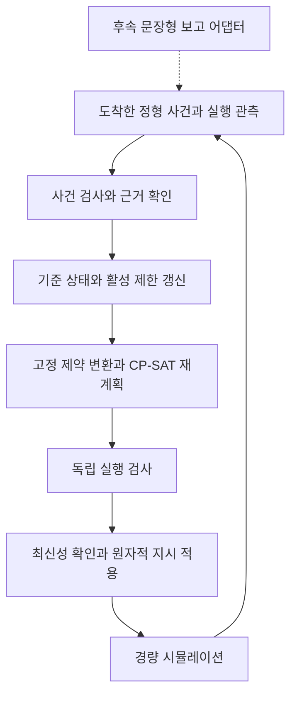

# 최소 정형 사건 처리의 구현 아키텍처

2026-11-06 설계. **단일 Python 실행 프로그램 안에서 모듈을 나눈다. 아래 코드·명령·데이터 경로는 구현 예정이며 현재 실행 가능한 애플리케이션은 없다.** 첫 구현은 로봇 2대·작업 5개의 정형 사건을 처리한다. 문장형 보고와 에이전트는 같은 처리 경로 앞에 나중에 연결한다.

기술 선택과 비교 근거는 [결정 기록](decisions.md), 필드·전이·시간·실패·정책의 규범은 [데이터 계약](data-contracts.md), 실제 구현 순서는 [다음 작업](next-steps.md)에 둔다. 이 문서는 모듈의 책임·권한·의존관계와 파일 배치를 설명한다. 계약이 바뀌면 이 문서와 구현 작업도 함께 갱신한다.

## 원본에서 유지하는 구조와 구체화한 선택

R은 원본 중간보고서, B는 프로젝트 기준 문서 v1.0이며 파일 식별은 [출처 기록](sources.md)을 따른다. 두 원본은 로컬 `references-local/`에서 확인했다.

| 원문 파일·절 → 요구사항 | 이번 선택 | 유지·변경 이유 |
| --- | --- | --- |
| R §4.1, B §4 → 정형 입력과 문장형 보고는 구조화 사건 검사에서 합류 | 공통 `events`·`controller` 경로, 후속 보고 어댑터는 사건 제안만 생성 | 원본의 AI/결정적 코드 분리를 유지. 최초 흐름에는 LLM이 필요 없음 |
| R §4.2, B §4·6 → 하나의 기준 상태와 근거를 일관되게 관리 | Python 표준 `sqlite3`를 이용하는 SQLite, 단일 쓰기 담당 `repository` | 원본의 관계형 저장을 로컬 단일 프로세스에 구체화. 별도 DB 서버·ORM의 운영 비용을 먼저 추가할 이유가 없음 |
| R §4.3, B §4 → JSON 사건과 고정 제약 규칙 | JSON·Pydantic 2 계약, `events`와 `constraints` 분리 | 원본 JSON을 유지하고 필수 필드·enum·버전·근거 연결을 실행 가능한 검사 대상으로 정의 |
| R §4.4, B §6 → 배정·선행·구역·이동/준비·진행 고정 | `scheduler`의 OR-Tools CP-SAT 9.15.6755 어댑터 | CP-SAT 기본안을 유지. Gurobi와 비교한 선택 근거는 DEC-01에 기록 |
| R §4.5, B §3·4 → 독립 검사 후 최신 상태에서 자동 적용 | `checker`와 `controller`의 원자적 적용을 분리 | 솔버의 제약 코드와 다른 검사 로직, 상태 변경 경쟁과 중복 지시를 다루는 경계를 명시 |
| R §4.6, B §3·6 → 경량 사건 시뮬레이션 | 표준 `heapq`의 사건 큐와 명시적인 phase 모델 | 원본 경량 시뮬레이터를 구체화. 물리 로봇 제어·용접 물리·3D 시뮬레이션은 범위 밖 |
| R §4.7, B §4·5 → 독립 정답과 추적 가능한 결과 | 실행 전 `checker`, 사후 `evaluation/score.py`, DB 기반 출력 | 실행 허용 판단과 연구 채점을 분리. 시스템의 자체 통과 결과를 정답으로 재사용하지 않음 |

런타임은 Python 3.13.18, 환경·패키지 관리는 uv다. 개발 검증은 pytest, 실행 진입점은 표준 argparse CLI다. 현재 선택에는 API 서버·웹 UI·에이전트 프레임워크를 포함하지 않는다. 한 명령으로 로컬 사례를 실행하고 파일로 기록을 확인하는 요구에는 별도 서비스가 필요하지 않다.

## 핵심 처리 흐름



그림의 DB 쓰기 화살표는 직접 수정 권한을 뜻하지 않는다. `controller`가 검증된 변경을 `repository`의 제한된 쓰기 메서드에 전달한다. 솔버와 에이전트는 기준 상태를 직접 바꾸지 않는다. 시뮬레이터도 DB를 직접 갱신하지 않고 실제 phase 시작·완료 관측을 반환한다.

1. CLI가 개발 정책과 공개 초기 상태를 검사하여 controller를 초기화한다. 실행 드라이버는 시뮬레이터 전용 외부 사건 파일을 따로 로드한다.
2. 드라이버가 현재 tick까지 도착한 사건·실행 관측만 전달한다. `events`는 ID·근거·대상·현재성·중복·충돌을 검사한다.
3. controller가 사건 처리 결과와 활성 제한 변경을 저장한다. 제한은 원인별로 유지하며, 복구는 자신이 가리키는 제한만 해제한다.
4. 공개 `PlanningSnapshot`에서 필수 계획 대상과 사유가 있는 제외 대상을 결정하고, 고정 규칙으로 제약을 만든다. 솔버가 작업을 임의로 빠뜨려 목적값을 낮추지 못하게 한다.
5. 솔버는 후보 계획과 해 상태를 반환한다. checker는 같은 기준 상태의 원자료로 제약·정책을 독립적으로 확인한다.
6. controller는 적용 직전의 상태 버전·tick·활성 계획 버전을 다시 확인한다. 불일치하면 적용하지 않고 최신 상태로 재계산한다. 통과하면 계획·지시·감사 기록을 함께 저장한다.
7. 드라이버가 적용된 지시만 시뮬레이터에 전달한다. 실제 다음 phase 시작 시에도 최신 전제조건을 확인하며, 시작·완료 관측은 다시 공통 처리로 들어온다.
8. 공개 복구 근거가 도착하면 W17의 해당 제한을 해제하고 재계획한다. W20의 실제 시작 허용은 W17의 실제 완료 기록으로 판단한다.

## 모듈 책임과 권한

아래 함수 이름은 구현할 내부 인터페이스다. 별도 HTTP API를 뜻하지 않는다. DTO의 정확한 필드와 실패 코드는 데이터 계약을 따른다. 외부 근거는 ArrivalBatch의 published_evidence로 도착하며 완료된 phase는 execution_progress에 남긴다. 진행 fixed segment와 잔여 suffix를 중복 자원 구간으로 넣지 않는다.

| 파일·내부 인터페이스 | 입력 → 출력 | 상태 변경 권한과 의존관계 |
| --- | --- | --- |
| `contracts.py` | JSON 값 → 타입이 검사된 작업·로봇·근거·사건·계획·관측 DTO | 순수 스키마·enum·구조 검사. DB·솔버·파일 I/O 없음. 의미가 맞는지의 업무 검사는 각 모듈에서 수행 |
| `repository.py`: `initialize`, `read_snapshot`, `commit_event`, `apply_plan`, `commit_observation` | 검사된 초기값/변경 명령 → 저장 결과·새 버전·조회 DTO | **기준 DB의 유일한 쓰기 구현**. controller만 쓰기 메서드를 호출. 트랜잭션·고유 ID·버전 비교·로그 연결 담당 |
| `events.py`: `validate_event`, `propose_restriction_changes` | 사건·현재 공개 상태·조회 근거 → 수락/중복/부족/충돌 결과와 제한 변경 제안 | 쓰기 없음. Pydantic을 통과한 입력도 출처·대상·유효 범위를 재검사. 근거 조회는 읽기 인터페이스로만 수행 |
| `constraints.py`: `build_constraints` | 공개 상태·활성 제한·정책 → 필수/제외 작업과 정형 제약 집합 | 쓰기 없음. 제한·선행·능력·가용·구역·이동/준비·현재 phase를 고정 규칙으로 변환. 임의 코드/수식 입력 없음 |
| `scheduler.py`: `solve` | 정형 제약 집합·공개 상태·솔버 설정 → 후보 계획·해 상태·목적값·계산 기록 | 쓰기·실행 권한 없음. CP-SAT 모델과 상태 변환 담당. 미래 외부 사건이나 평가 정답을 받지 않음 |
| `checker.py`: `check_plan`, `check_phase_start` | 후보/지시·현재 공개 상태·정책 → 허용/거부와 위반 목록 | 쓰기 없음. `constraints`·`scheduler`를 import하지 않으며 솔버의 self-check를 정답으로 사용하지 않음. 공통 DTO 정의는 공유 가능 |
| `controller.py`: `initialize`, `handle_batch`, `plan_and_apply`, `authorize_phase_start` | 도착 사건/관측·공개 저장소 인터페이스·정책 → 처리 결과·적용 지시·대기/확인 요청 | 저장소 쓰기를 조율하는 유일한 업무 모듈. 제한된 순서로 events→constraints→scheduler→checker→repository를 호출. simulator의 private 큐나 evaluator를 참조하지 않음 |
| `simulator.py`: `due_events`, `accept_instructions`, `advance`, `emit_observations` | 전용 외부 사건 큐·적용 지시 → 현재 도착 사건·phase 관측·실제 실행 기록 | **기준 DB 쓰기 없음**. 내부 물리/시간 상태와 미래 큐는 공개 DTO와 분리. 승인된 다음 phase만 시작. 실제 로봇 제어 없음 |
| `reporting.py`: `export_run`, `inspect_run` | 완료/중단된 실행 DB → 공개 JSONL·CSV·CLI 요약 | 읽기 전용. DB를 기준으로 출력 생성. CSV나 JSONL을 다시 기준 상태처럼 수정·사용하지 않음 |
| `cli.py`, `__main__.py` | 명령행 인자·설정 → 실행 드라이버/검사/출력 호출 | 의존성 연결과 입출력 경로 검증. 기준 상태 변경은 controller 경유. 공개 초기값·미래 큐·평가자료를 한 DTO로 합치지 않음 |
| `evaluation/score.py` | 실행 출력·독립 정답·평가자 환경 사실 → 사건별 점수·오류 이유 | 애플리케이션 실행 후 별도 명령. `checker`·`constraints`·`scheduler`의 판정 함수를 사용하지 않고 독립 채점. 운영 지시·DB 수정 권한 없음 |

### 의존관계 규칙

- `contracts`는 하위 공통 정의이고 업무 모듈을 참조하지 않는다. `repository`는 저장 계약을 구현하며 솔버·시뮬레이터를 호출하지 않는다.
- `constraints`, `scheduler`, `checker`는 복사된 공개 DTO를 받는다. 로더 전체·저장소 파일 경로·시뮬레이터 객체를 받지 않는다.
- controller가 공개 업무 흐름을 조율하고 CLI의 드라이버가 시간 진행과 외부 사건 도착을 조율한다. controller에 미래 큐를 가진 simulator 객체를 넘기지 않는다.
- checker는 솔버 모델의 제약 생성 코드를 재호출하지 않는다. evaluator는 checker의 허용 판정을 채점 결과로 가져오지 않는다.
- 에이전트가 추가되어도 공개 조회 도구와 사건 제안 제출만 허용한다. 일반 파일 읽기·SQL 실행·shell·동적 코드 실행을 도구로 제공하지 않는다.

## 기준 상태와 계획 적용

SQLite 한 파일을 실행별 기준 저장소로 사용한다. 초기값·근거·사건 수신 이력·활성 제한·후보 계획·검사 결과·지시·관측·감사 로그를 연결한다. 테이블과 필수 키는 데이터 계약을 따른다. `schema.sql`은 이 명세를 실제 DDL로 옮기는 다음 구현의 산출물이다.

상태 버전은 업무 상태가 변했을 때 증가한다. 단순 조회나 감사 로그 추가를 상태 변화로 세어 계산 중인 계획을 불필요하게 무효화하지 않는다. 계획은 계산 기준의 상태 버전·tick·활성 계획 버전을 보존한다.

적용은 다음 한 트랜잭션으로 구현한다. 쓰기 잠금과 비교를 끝내기 전에 사용자 입력이나 솔버 계산을 기다리지 않는다.

1. 적용 기대값과 현재 상태 버전·tick·활성 계획 버전이 같은지 검사한다.
2. checker 결과가 해당 후보·정책·상태에 대한 결과인지 확인한다.
3. 진행 중인 phase는 보존하고, 이전 계획의 아직 시작하지 않은 지시는 폐기/대체한다.
4. 새 계획의 활성화·지시 등록·상태 버전 변경·감사 로그를 함께 기록한다.
5. 하나라도 실패하면 전체 적용을 취소한다. 오래된 후보는 새 스냅샷에서 재계산하며 이전 검사 결과를 재사용하지 않는다.

이미 진행 중인 phase의 완료 관측은 이전 계획이 교체되었다는 이유로 버리지 않는다. phase와 실행 ID로 현재 진행 사실을 확인하여 처리한다. 반대로 취소된 계획의 아직 시작하지 않은 phase는 착수할 수 없다. 동일 사건·지시·관측을 다시 전달해도 업무 상태를 중복 변경하지 않는 고유 키와 결과 조회 계약을 둔다.

`INFEASIBLE`, 제한시간 내 해 미발견, 최적성 미증명의 실행 가능 해, 근거 부족은 서로 다른 경로다. 재시도 상한과 자동 적용 정책은 [데이터 계약의 실패 처리](data-contracts.md)를 따르며, 실패를 물리 제약 완화로 해결하지 않는다.

## 실행 phase와 시간 진행

작업 생명주기는 `NOT_STARTED → COMMITTED → RUNNING → COMPLETED`를 기본으로 한다. `COMMITTED`는 첫 이동/준비 phase가 실제 시작되어 용접 전 실행을 진행하는 단계이며 `RUNNING`은 용접이 실제로 시작된 단계다. 보류·준비 부족·선행 차단은 이 생명주기와 별개인 제한과 파생 실행 가능성이다. 취소/재계획 시의 전이는 데이터 계약을 따른다.

| 로봇 phase | 사용하는 자원 | 재계획과 실행 조건 |
| --- | --- | --- |
| `IDLE` | 현재 위치만 유지 | 유효한 새 지시를 받을 수 있음 |
| `MOVING` | 로봇. 이동 경로의 구역 충돌은 개발 모델에 포함하지 않음 | 시작한 이동 phase는 완료까지 고정. 완료 시 도착 위치를 보존 |
| `WAITING_FOR_ZONE` | 로봇, 대상 작업 예약. 구역은 아직 점유하지 않음 | 이동 후 구역을 기다림. 재계획으로 취소할 수 있으나 도착 위치 유지 |
| `SETTING_UP` | 로봇과 대상 구역 | 시작한 준비 phase는 완료까지 고정. 완료 후 새 제한이 있으면 용접을 시작하지 않음 |
| `WELDING` | 로봇과 대상 구역 | 용접을 완료까지 유지. W18의 기존 배정·시작·완료 시각을 재계획이 변경하지 못함 |

구간은 `[start,end)`다. 이동은 다른 구역 1 tick·동일 구역 0 tick, 준비는 1 tick이라는 개발 기본값을 사용하며 [개발 사례](../data/README.md)의 가정임을 유지한다. 미래 계획에 선행 작업과 후속 작업의 연결 일정을 함께 계산할 수 있지만, **W20은 이동·준비·용접 각 phase를 시작하기 전에 W17의 실제 완료를 확인**한다. 계획의 예상 완료 시각이나 W17의 핏업 복구만으로 gate를 통과하지 못한다.

이동·준비 중 새 제한이 도착하면 현재 phase까지만 비선점으로 완료한다. controller는 완료 관측으로 위치·점유를 반영하고 다음 phase를 막거나 새 계획을 계산한다. 기존 계획의 나머지를 자동 진행하거나 현재 위치를 예전 값으로 되돌리지 않는다. 원본의 시작 전 범위를 넘어 이미 용접 중인 작업을 중단시키는 실험은 이번 구현에 넣지 않는다.

동일 tick은 다음 순서로 처리한다.

1. 진행 중 phase의 실제 완료 관측을 처리한다.
2. 해당 tick에 도착한 외부 사건과 그때 공개되는 근거를 일괄 검사·저장한다. 상충 근거를 먼저 대조하고 수신 순서로 덮어쓰지 않는다.
3. 필요한 재계획·독립 검사·원자적 적용을 수행한다.
4. 최신 전제조건을 만족하는 다음 phase만 시작한다.

0 tick 이동처럼 길이가 0인 phase는 같은 tick의 유한한 마이크로스텝으로 완료 처리하고 다음 phase 시작 gate를 다시 확인한다. 같은 지시를 계속 재삽입하는 무한 반복을 금지한다. 외부 사건과 착수가 같은 tick이면 외부 제한 반영이 먼저다. 개발 시뮬레이션은 계산의 실제 벽시계 소요시간과 추상 tick을 별도로 기록하며, 본 평가에서 계산시간을 공정 시간에 반영하는 방법은 DEC-08에 남긴다.

## 평가 정보와 미래 사건의 접근 경계

| 정보 | 소유·읽는 곳 | 시스템에 전달하는 범위 |
| --- | --- | --- |
| 현재 공개 상태·도착한 근거 | repository | allowlist로 새로 만든 공개 snapshot/조회 응답 |
| 아직 도착하지 않은 외부 사건·복구 시각 | simulator의 전용 큐와 실행 드라이버 | 현재 tick에 도착한 사건만 전달 |
| 평가자 정답 `oracle.json` | 별도 평가 명령 | controller·에이전트·솔버에 전달하지 않음 |
| 평가자 환경 사실 `truth.jsonl` | 별도 평가 명령 | 사전 작성한 평가자 기준 사실. 공개 운영 근거나 프롬프트로 전달하지 않음 |
| 실제 지시·시작·완료·개입 기록 | 실행 DB와 출력 | 시스템 추적과 사후 채점에 사용. 평가자 정답과는 별도 |

폴더 분리는 배치 규칙일 뿐 정보 차단의 구현 증거가 아니다. 첫 구현에서 다음을 함께 검증한다.

- 공개 초기값 로더가 정해진 파일·필드만 읽고 미래 사건·oracle·truth를 병합하지 않는다. 공개 DTO는 미정의 필드를 거부한다.
- 솔버와 에이전트 입력을 allowlist로 새로 구성한다. 원본 scenario 객체나 simulator 참조를 통째로 전달하지 않는다.
- 의존관계 검증으로 controller/solver/agent가 evaluation 로더나 simulator의 private 큐를 직접 참조하지 못하게 한다. checker와 evaluator의 금지 import도 확인한다.
- 미래 큐와 평가 자료에 고유 sentinel 값을 넣은 검사에서 공개 snapshot·조회 응답·프롬프트·솔버 입력으로 그 값이 나오지 않는지 확인한다.
- 평가 명령은 실행 종료 후 출력과 평가 전용 경로를 읽는다. 정답은 시스템 출력과 독립적으로 작성하고 교차 검토한다.

이는 단일 프로세스의 의존성과 데이터 흐름을 검증하는 설계다. 악의적인 Python 코드에 대한 운영체제 수준 보안 격리를 구현했다고 주장하지 않는다. 실제 읽기 권한 분리가 필요한 배포 환경은 이후 별도 프로세스·계정·파일 권한 등으로 검토한다.

## 구현할 파일 배치

아래 트리는 **예정 경로**다. 이번 문서 작업에서 빈 모듈이나 실행 데이터를 생성하지 않는다. D02–D04는 D01과 같은 구조로 개발 사례를 확장한다.

```text
.
├── pyproject.toml                       # 다음 구현에서 의존성과 패키지 정의
├── uv.lock                              # 다음 구현의 실제 해결 결과
├── .python-version                      # 검증한 Python 패치 버전
├── config/
│   └── dev-policy.json                  # 개발 정책·솔버 설정·계약 버전
├── data/dev/D01/
│   ├── initial.json                     # 시스템 공개 초기 상태
│   └── evidence.json                    # 현재까지 공개된 근거
├── simulation/dev/D01/
│   └── events.jsonl                     # 드라이버만 읽는 외부 사건 흐름
├── src/shipyard/
│   ├── __init__.py
│   ├── __main__.py
│   ├── cli.py
│   ├── contracts.py
│   ├── repository.py
│   ├── schema.sql
│   ├── events.py
│   ├── constraints.py
│   ├── scheduler.py
│   ├── checker.py
│   ├── controller.py
│   ├── simulator.py
│   └── reporting.py
├── tests/                               # 계약·모듈·실패 주입·통합 검증
├── evaluation/
│   ├── score.py
│   └── dev/D01/
│       ├── oracle.json                  # 독립 작성한 허용·금지 행동
│       └── truth.jsonl                  # 평가자 전용 환경 사실
└── outputs/D01/                         # 실행 생성물, Git 제외
    ├── run.sqlite3                      # 기준 상태와 추적 기록
    ├── manifest.json                    # 실행 환경·버전·입력 해시
    ├── trace.jsonl                      # DB에서 내보낸 공개 추적 기록
    ├── execution.csv                    # 실제 phase 시작·완료 기록
    └── summary.json                     # 운영 요약, 독립 채점과 구별
```

기존 `src/README.md`, `data/README.md`, `tests/README.md`, `evaluation/README.md`는 해당 위치의 설명으로 유지한다. 이번에 새로 만든 `docs/architecture.md`는 흩어진 모듈 설명을 연결하고 미래 실제 파일 배치를 정하기 위한 문서다. 기존 파일을 이동하거나 원본 자료를 바꾸지 않는다. 필드·실패 정책은 `docs/data-contracts.md`에 모아 중복 정의를 줄인다.

## 구현 후 제공할 명령

다음 명령은 아직 동작을 확인하지 않은 **구현 대상 인터페이스**다. `pyproject.toml`, lockfile, 데이터와 애플리케이션 구현 후 실행을 확인하고 README를 갱신한다. `uv run --locked`는 lockfile이 만들어진 후 사용한다.

```bash
uv run --locked python -m shipyard run --case D01 --output outputs/D01
uv run --locked python -m shipyard inspect --run-dir outputs/D01
uv run --locked python evaluation/score.py --run-dir outputs/D01 --oracle evaluation/dev/D01/oracle.json --truth evaluation/dev/D01/truth.jsonl
uv run --locked pytest
```

`run`은 공개 데이터 경로와 드라이버 전용 사건 경로를 정해진 case 규칙으로 해석한다. `inspect`는 DB와 내보낸 기록에서 사건→근거→제한→계획→검사→지시→실제 실행을 보여준다. `score.py`는 명시적으로 전달된 독립 정답과 환경 사실로 채점한다. 같은 출력 경로가 이미 있으면 기본적으로 덮어쓰지 않고 새 경로를 요구한다. 실행·채점 결과가 나오기 전에는 통과나 성능 개선을 완료로 기록하지 않는다.

## 후속 연결

정형 흐름과 M01–M10을 통과한 뒤 문장형 보고 어댑터를 추가한다. 단일 에이전트와 해석·근거 확인·조율 역할 분리는 같은 공개 도구와 최종 사건 계약, 같은 controller·솔버·검사기·시뮬레이터를 공유한다. 역할을 나눈다는 이유로 DB를 복제하거나 솔버를 여러 제품으로 구현하지 않는다. 조회와 자기 검토는 단일 구조에도 허용하고 동일한 모델·자료·호출/토큰 상한을 적용한다.

LLM SDK·모델·agent 구성의 추천과 미결정 범위는 DEC-07을 따른다. 정형 경로의 필수 의존성에 모델 API·agent framework를 넣지 않는다. OCR·웹 UI·3D·클라우드는 핵심 흐름에 필요한 근거가 생기면 DEC-09에서 별도로 판단한다.
