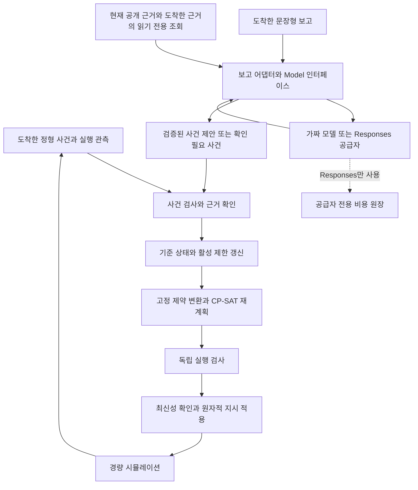

# 최소 사건·문장형 보고 처리의 구현 아키텍처

2026-11-07 구현 반영. **단일 Python 실행 프로그램에서 로봇 2대·작업 5개의 D01–D04 정형 사건과 가짜 모델을 사용하는 문장형 보고를 처리한다.** 같은 보고 인터페이스에 OpenAI Responses 공급자 어댑터와 별도 비용 원장을 구현했다. 모든 입력은 같은 근거·사건 검사, 상태 저장, 재계획, 독립 실행 검사, 시뮬레이션과 추적 경로에 합류한다. **사용자는 Luna·제안된 상한·합성 D01 1회 실행을 승인했다. 실제 계정 API·토큰 count·모델 생성은 아직 0회다.** 실행 환경의 자격 증명이 준비되지 않았고 count API의 별도 청구·보관 조건은 미해결 상태다. 가짜 모델·모의 HTTP 검사는 자연어 해석 성능이나 실제 서비스 호환성의 검증이 아니다. 단일/역할 분리 비교와 본 비교실험은 아직 수행하지 않았다.

기술 선택과 비교 근거는 [결정 기록](decisions.md), 필드·전이·시간·실패·정책의 규범은 [데이터 계약](data-contracts.md), 실제 구현 순서는 [다음 작업](next-steps.md)에 둔다. 이 문서는 모듈의 책임·권한·의존관계와 파일 배치를 설명한다. 계약이 바뀌면 이 문서와 구현 작업도 함께 갱신한다.

## 원본에서 유지하는 구조와 구체화한 선택

R은 원본 중간보고서, B는 프로젝트 기준 문서 v1.0이며 파일 식별은 [출처 기록](sources.md)을 따른다. 두 원본은 로컬 `references-local/`에서 확인했다.

| 원문 파일·절 → 요구사항 | 이번 선택 | 유지·변경 이유 |
| --- | --- | --- |
| R §4.1·4.3, B §4 → 정형 입력과 문장형 보고는 구조화 사건 검사에서 합류 | 공통 `events`·`controller` 경로, `reports.interpret_report`는 읽기 전용 조회와 사건 제안만 수행 | 원본의 AI/결정적 코드 분리를 유지. 가짜 모델로 경계를 먼저 구현하며 정형 흐름에는 LLM이 필요 없음 |
| R §4.2, B §4·6 → 하나의 기준 상태와 근거를 일관되게 관리 | Python 표준 `sqlite3`를 이용하는 SQLite, 단일 쓰기 담당 `repository` | 원본의 관계형 저장을 로컬 단일 프로세스에 구체화. 별도 DB 서버·ORM의 운영 비용을 먼저 추가할 이유가 없음 |
| R §4.3, B §4 → JSON 사건과 고정 제약 규칙 | JSON·Pydantic 2 계약, `events`와 `constraints` 분리 | 원본 JSON을 유지하고 필수 필드·enum·버전·근거 연결을 실행 가능한 검사 대상으로 정의 |
| R §4.4, B §6 → 배정·선행·구역·이동/준비·진행 고정 | `scheduler`의 OR-Tools CP-SAT 9.15.6755 어댑터 | CP-SAT 기본안을 유지. Gurobi와 비교한 선택 근거는 DEC-01에 기록 |
| R §4.5, B §3·4 → 독립 검사 후 최신 상태에서 자동 적용 | `checker`의 검사, `controller`의 업무 조율, `repository.apply_plan`의 원자적 적용을 분리 | 솔버의 제약 코드와 다른 검사 로직, 상태 변경 경쟁과 중복 지시를 다루는 경계를 명시 |
| R §4.6, B §3·6 → 경량 사건 시뮬레이션 | 표준 `heapq`의 사건 큐와 명시적인 phase 모델 | 원본 경량 시뮬레이터를 구체화. 물리 로봇 제어·용접 물리·3D 시뮬레이션은 범위 밖 |
| R §4.7, B §4·5 → 독립 정답과 추적 가능한 결과 | 실행 전 `checker`, 사후 `evaluation/score.py`, DB 기반 출력 | 실행 허용 판단과 연구 채점을 분리. 시스템의 자체 통과 결과를 정답으로 재사용하지 않음 |

런타임은 Python 3.13.18, 환경·패키지 관리는 uv다. 개발 검증은 pytest, 실행 진입점은 표준 argparse CLI다. 현재 선택에는 API 서버·웹 UI·에이전트 프레임워크를 포함하지 않는다. 한 명령으로 로컬 사례를 실행하고 파일로 기록을 확인하는 요구에는 별도 서비스가 필요하지 않다.

첫 유료 파일럿은 **`gpt-6-luna` 해석기 하나**로 보고를 읽고 허용된 근거 조회와 사건을 제안한다. 조회는 `reports`, 제약 변환은 `constraints`, 재계획은 `scheduler`의 CP-SAT, 실행 검사는 `checker`, 상태 저장은 `controller`가 호출하는 `repository`가 수행한다. 이 Python 모듈들이 실제 처리 도구이며 모델의 제안을 공통 계약으로 다시 검사한다. Luna의 한국어 해석 품질은 승인된 D01 실행에서 확인할 대상이고, 현재 더 큰 모델이나 여러 에이전트가 필요하다는 실험 결과는 없다.

실행 환경은 **로컬 `.venv`**를 사용한다. `.python-version`은 Python 3.13.18을 지정하고, `pyproject.toml`은 의존성을 선언하며, `uv.lock`은 설치할 패키지 버전을 고정한다. `uv sync --locked`로 설치하고 lockfile이 설정과 맞지 않으면 자동 갱신 대신 오류를 내도록 한다. Responses 실행에만 `--extra llm`으로 OpenAI SDK를 추가한다. [uv의 lockfile·동기화 공식 문서](https://docs.astral.sh/uv/concepts/projects/sync/).

Docker는 팀원의 구체적인 OS 호환 문제나 서버 배포 요구가 생기면 검토한다. 그때 이미지는 프로젝트 코드·Python·라이브러리를 함께 배포하는 용도로 사용할 수 있다. **API로 사용하는 Luna는 이미지에 포함되지 않으며, 컨테이너가 외부 모델의 동작까지 고정하지는 않는다.** 현재 로컬 실행에 Dockerfile이나 모델용 GPU를 추가할 필요는 없다. 후속 컨테이너 구성은 [uv의 Docker 통합 공식 문서](https://docs.astral.sh/uv/guides/integration/docker/)를 기준으로 검토한다.

## 핵심 처리 흐름



그림의 DB 쓰기 화살표는 직접 수정 권한을 뜻하지 않는다. `controller`가 검증된 변경을 `repository`의 제한된 쓰기 메서드에 전달한다. 솔버는 기준 상태를 직접 바꾸지 않는다. phase 시작은 controller가 승인·저장하고, simulator는 승인된 시작 관측으로 완료 사건을 예약하여 해당 tick에 반환한다. simulator는 DB를 직접 갱신하지 않는다. 여기서 실제 시작·완료는 경량 시뮬레이션 안의 실행 사실이며 물리 로봇 관측이 아니다.

1. CLI의 `run_case`가 개발 정책과 공개 초기 상태를 검사하고 `Repository.initialize`와 `Controller`를 구성한다. CLI 실행 드라이버는 시뮬레이터 전용 외부 사건 파일을 따로 로드한다. `--report-mode fake`에서는 `simulation/reports/D01.jsonl`의 문장·가짜 응답도 드라이버가 로드하고, 도착한 보고의 응답만 해당 batch의 `FakeReportModel`에 제공한다. `responses`는 같은 파일의 도착한 보고 문장만 사용하고 가짜 응답을 공급자에 전달하지 않는다. 이 모드의 실행 전에는 별도 LLM 정책·승인 플래그·자격 증명·동결한 D01 입력 해시를 확인한다.
2. 드라이버가 현재 tick까지 도착한 사건·실행 관측만 전달한다. 문장형 경로에서는 먼저 완료 관측을 반영한 뒤 보고 중복/충돌, 출처·대상·공개 근거를 검사하고 `interpret_report`로 사건을 제안한다. 두 경로 모두 repository의 사건 ID·fingerprint 검사와 `events.apply_deliveries`의 출처·근거·대상·현재성·상반된 관측 검사를 거친다.
3. controller가 사건 처리 결과와 활성 제한 변경을 저장한다. 제한은 원인별로 유지하며, 복구는 자신이 가리키는 제한만 해제한다.
4. 공개 `PlanningSnapshot`에서 필수 계획 대상과 사유가 있는 제외 대상을 결정하고, 고정 규칙으로 제약을 만든다. 솔버가 작업을 임의로 빠뜨려 목적값을 낮추지 못하게 한다.
5. 솔버는 후보 계획과 해 상태를 반환한다. checker는 같은 기준 상태의 원자료로 제약·정책을 독립적으로 확인한다.
6. controller가 `Repository.apply_plan`을 호출하면 저장소가 적용 직전의 상태 버전·tick·활성 계획 버전과 검사 결과를 다시 확인한다. 불일치하면 적용하지 않고 controller가 최신 상태로 재계산한다. 통과하면 계획·지시·감사 기록을 함께 저장한다.
7. CLI 드라이버가 적용된 pending 지시의 시작을 `Controller.authorize_phase_start`에 요청한다. 현재 전제조건 검사를 통과한 시작만 저장하며, 그 관측을 `Simulator.register_completion`에 전달한다. 완료 관측은 `handle_batch`로 돌아온다.
8. 공개 복구 근거가 도착하면 W17의 해당 제한을 해제하고 재계획한다. W20의 실제 시작 허용은 W17의 실제 완료 기록으로 판단한다.

## 모듈 책임과 권한

아래는 실제 구현된 내부 인터페이스다. 별도 HTTP API가 아니다. DTO 정의는 `contracts.py`, 필드의 의미와 실패 정책은 데이터 계약을 따른다. 외부 근거는 `ArrivalBatch.deliveries[].published_evidence`로 도착하며 완료된 phase는 `execution_progress`에 남는다. 진행 fixed segment와 잔여 suffix는 서로 겹치는 자원 구간으로 중복 등록하지 않는다.

| 파일·내부 인터페이스 | 입력 → 출력 | 상태 변경 권한과 의존관계 |
| --- | --- | --- |
| `contracts.py` | JSON 값 → 타입이 검사된 작업·로봇·근거·사건·계획·관측 DTO | 순수 스키마·enum·구조 검사. DB·솔버·파일 I/O 없음. 의미가 맞는지의 업무 검사는 각 모듈에서 수행 |
| `repository.py`: `Repository.initialize`, `read_snapshot`, `report_receipts`, `filter_deliveries`, `commit_event_batch`, `record_plan`, `apply_plan`, `commit_observation` | 검사된 초기값/변경 명령 → 저장 결과·새 버전·조회 DTO | **기준 DB의 유일한 쓰기 구현**. 최초 초기화는 CLI, 이후 업무 갱신은 controller가 호출. `commit_event_batch(..., report_results=...)`는 보고 결과와 사건·상태를 함께 저장 |
| `reports.py`: `ReportInput`, `ReportDelivery`, `ReportModel.respond`, `FakeReportModel`, `interpret_report`, `fallback_delivery` | 현재 도착 보고·공개 snapshot·모델 인터페이스 → `AdapterResult`와 선택적 `Delivery` | DB·파일 경로·simulator를 받지 않음. 허용된 근거 조회, 엄격한 모델 응답 검사, 호출/크기 제한, 확인 필요 fallback을 담당. 모델 출력은 최종 업무 판정이 아님 |
| `responses.py`: `LLMPolicy`, `ResponsesReportModel.respond`, `preflight`, `validate_live_inputs` | 검사된 보고 요청·미승인/승인 정책·비용 원장 → 공통 모델 응답 또는 `ModelCallFailure` | 기준 DB·미래 큐·평가자료를 받지 않음. SDK는 필요할 때만 import. 입력 토큰 count, strict function calling, 공급자 응답/오류 검사와 호출 제한을 담당. `preflight`의 기본값은 네트워크 없이 설정을 조회 |
| `llm_budget.py`: `BudgetLedger.reserve`, `settle`, `summary` | 프로젝트/실행/보고 ID·생성 비용 예약/사용량 기반 추정액 → 예산 허용/거부·원장 요약 | 기준 DB와 별도 SQLite에만 쓰기. 원자적 사전 예약과 누적 상한 검사, 결과 미확정 예약 유지. operational 상태·지시 변경 권한 없음 |
| `events.py`: `apply_deliveries(snapshot, deliveries)` | 공개 상태·현재 도착 근거/사건 → 갱신 제안 snapshot과 사건별 처리 결과 | DB 쓰기 없음. 공개 DTO의 사본에서 출처·대상·유효 범위를 재검사하고 제한·근거 변경을 제안. 저장과 중복 ID 처리는 repository 담당 |
| `constraints.py`: `build_constraints` | 공개 상태·활성 제한·정책 → 필수/제외 작업과 정형 제약 집합 | 쓰기 없음. 제한·선행·능력·가용·구역·이동/준비·현재 phase를 고정 규칙으로 변환. 임의 코드/수식 입력 없음 |
| `scheduler.py`: `solve(snapshot, constraints, policy)` | 공개 상태·정형 제약 집합·정책 → 후보 계획·해 상태·목적값·단계별 bound·계산 기록 | 쓰기·실행 권한 없음. CP-SAT 모델, 인접 작업의 이동, 4단계 목적, 이전 incumbent 보존 담당. 미래 외부 사건이나 평가 정답을 받지 않음 |
| `checker.py`: `check_plan`, `check_phase_start` | 후보/지시·현재 공개 상태·정책 → 허용/거부와 위반 목록 | 쓰기 없음. `constraints`·`scheduler`를 import하지 않으며 솔버의 self-check를 정답으로 사용하지 않음. 공통 DTO 정의는 공유 가능 |
| `controller.py`: `Controller.handle_batch`, `handle_report_batch`, `plan_and_apply`, `authorize_phase_start`, `complete_phase` | 도착 사건/보고/관측·공개 저장소 인터페이스·정책 → 처리 결과·시작 관측·대기/확인 요청 | 저장 순서를 조율하는 업무 모듈. 보고 해석 뒤에도 같은 events→constraints→scheduler→checker→repository 경로를 호출. 오래된 해석 결과는 최신 상태의 확인 필요 사건으로 전환 |
| `simulator.py`: `Simulator.load`, `register_completion`, `due_events`, `next_tick` | 전용 외부 사건 파일·승인된 시작 관측 → 현재 도착 사건/완료 관측·드라이버용 다음 tick | **기준 DB 쓰기 없음**. 두 heapq에 미래 외부 입력과 완료 관측을 보관하며 CLI에만 다음 tick을 제공. 시간 진행과 지시 시작 호출은 CLI 담당 |
| `reporting.py`: `export_run`, `inspect_run` | 읽기 전용 실행 DB → JSONL·CSV·JSON 요약; 저장된 summary → 조회 결과 | 기준 DB를 변경하지 않고 내보낸 파일을 작성. `inspect_run`은 `summary.json`을 읽으며 DB 전체 추적 탐색 UI는 없음 |
| `cli.py`: `load_public_case`, `run_case`, `main`; `__main__.py` | 명령행 인자·설정 → 사례 로딩·시간 진행·현재 지시 시작 요청·출력 | **시뮬레이션 실행 드라이버**. 초기 DB 생성 이후 업무 변경은 controller 경유. 공개 초기값·미래 큐·평가자료를 한 DTO로 합치지 않음 |
| `evaluation/score.py`: `score_records`, `score_run`, `main` | 실행 CSV/추적·독립 정답·평가자 환경 사실 → 개발 수락 채점·오류 이유 | 실행 후 별도 명령. 운영 검사 함수를 import하지 않고 독립 채점하여 `evaluation.json`/CSV 작성. 운영 지시·DB 수정 권한 없음. 본 비교실험 실행기는 아님 |

### 의존관계 규칙

- `contracts`는 하위 공통 정의이고 업무 모듈을 참조하지 않는다. `repository`는 저장 계약을 구현하며 솔버·시뮬레이터를 호출하지 않는다.
- `constraints`, `scheduler`, `checker`는 복사된 공개 DTO를 받는다. 로더 전체·저장소 파일 경로·시뮬레이터 객체를 받지 않는다.
- controller가 공개 업무 흐름을 조율하고 CLI의 드라이버가 시간 진행과 외부 사건 도착을 조율한다. controller에 미래 큐를 가진 simulator 객체를 넘기지 않는다.
- `reports`는 공개 snapshot을 받아 필요한 값만 새 모델 요청으로 직렬화한다. 모델 요청에는 보고·호스트 메타데이터·현재 ID 목록·버전/tick·허용 사건 종류와 조회 결과만 포함하며 전체 snapshot이나 미래 응답 대본을 넣지 않는다. 모델 응답 스키마에 호스트의 run/report/incident/source ID와 수신·관측 시각 변경 필드는 없다.
- `responses`는 내부 요청에서 외부 전송할 값을 한 번 더 제한한다. 최초 API 입력은 보고 본문·대상 힌트·현재 ID·허용 사건 종류·현재 tick이며, 조회 뒤에는 실제 조회 결과와 공급자의 이전 도구 호출을 연결한다. 호스트의 run/report/incident/source ID·수신/관측 시각·상태 버전은 로컬 검증에 사용하며 외부 입력에 복사하지 않는다. 기준 DB에 쓰는 코드와 비용 원장에 쓰는 코드는 서로 분리되어 있다.
- checker는 솔버 모델의 제약 생성 코드를 재호출하지 않는다. evaluator는 checker의 허용 판정을 채점 결과로 가져오지 않는다.
- 에이전트가 추가되어도 공개 조회 도구와 사건 제안 제출만 허용한다. 일반 파일 읽기·SQL 실행·shell·동적 코드 실행을 도구로 제공하지 않는다.

### 문장형 보고 경계

`interpret_report(ReportDelivery, PlanningSnapshot, ReportModel)`은 `lookup_evidence`, `propose`, `clarify`, `refuse` 응답을 엄격하게 검사한다. 보고당 최대 모델 2회·조회 1회이며 문장/응답/문맥 크기 상한은 DEC-07과 데이터 계약을 따른다. 조회는 현재 visible 근거와 해당 보고에 도착한 근거를 읽으며, 후자는 `ARRIVED_UNCOMMITTED`로 구별한다. 모델은 실제 조회에 반환된 근거·제한 ID만 인용할 수 있다. 사건의 값·권한·복구 연결은 공통 `events`에서 다시 검사한다.

보고 ID와 내용 fingerprint가 같은 재전달은 모델을 다시 호출하지 않는다. 다른 새 입력·시간/상태 변화가 없는 중복 보고만의 batch는 재계획도 하지 않는다. 같은 ID의 다른 내용은 충돌과 확인 요청을 기록한다. 해석 중 상태 버전이 바뀌면 `STALE_CONTEXT`로 기록하고, 최신 상태에서 검증한 호스트 대상 힌트가 있으면 그 대상의 `IDENTITY_UNCERTAIN` 사건으로 전환한다. 대상이 특정되지 않으면 `UNRESOLVED`로 확인을 요청하며 전 작업을 일괄 보류하지 않는다.

모델 timeout·거절·잘못된 형식·허용 한도 초과도 원인을 보존하고 같은 확인 필요 경로를 사용한다. 호스트 봉투의 run/tick/출처가 유효하지 않으면 모델을 호출하거나 사건을 제출하지 않는다. 보고 결과의 `READY`는 사건 제안을 만들었다는 뜻이며 상태 변경 승인이나 정답 판정이 아니다.

### Responses 공급자와 비용 경계

`ResponsesReportModel`은 기존 `ReportModel.respond`를 구현한다. 첫 응답의 native `function_call`을 보관하고, 읽기 전용 조회 뒤 두 번째 요청에는 같은 `call_id`의 `function_call_output`을 연결한다. 허용 도구는 `lookup_evidence`, `propose`, `clarify`이며 조회 뒤에는 다시 조회하는 도구를 제공하지 않는다. strict schema·단일 도구 호출 설정과 별개로 공통 어댑터가 응답 형태·조회 횟수·근거 ID·사건 제안을 재검사한다. 공급자 거절은 공통 거절 응답으로, timeout·인증/권한·요금/속도·프로토콜 오류는 `ModelCallFailure`로 전달되어 같은 확인 필요 fallback을 사용한다.

선택적 `openai==3.46.0`을 `llm` extra로 고정했다. 정형/fake 경로는 SDK를 import하거나 모델 API를 호출하지 않는다. 공급자는 공식 API 호스트를 사용하며 자동 재시도·환경 프록시·redirect를 끈다. 생성마다 같은 입력·도구·스키마의 토큰 수를 먼저 count하고, 한도를 통과한 경우에만 생성한다. **count 역시 보고 데이터를 전송하는 API 요청**이다. `store=false`, `background=false`, `stream=false`, `service_tier="default"`, explicit cache/no breakpoint는 생성 `create`에만 넣는다. count 메서드에 이 옵션이 없다는 사실로 보관·무료 조건이 같다고 추정하지 않는다. 값과 공식 근거는 [DEC-07](decisions.md#dec-07-문장형-보고-어댑터와-이후-llm-연결)을 따른다.

`config/llm-policy.json`은 현재 `approved_for_paid_calls=false`, `project_id=null`이다. 실제 실행에는 정책 승인 값과 `--allow-paid`가 모두 필요하며, 합성 D01의 공개 초기값·근거·사건 파일·보고 파일·개발 정책 다섯 파일의 SHA-256도 일치해야 한다. 첫 파일럿은 최대 3개 보고로 제한한다. 이 조건은 구현된 실행 gate이며 사용자 승인·모델 접근 가능성의 증거가 아니다.

비용 원장은 실행별 `run.sqlite3`와 다른 `artifacts/llm-budget.sqlite3`다. count를 보내기 전에 생성 최대 비용을 정수 micro-USD로 예약하고, usage를 받은 경우에만 단가 기반 추정액으로 정산한다. timeout·usage 누락·응답 불일치 등 결과가 미확정이면 예약을 남긴다. 정책과 원장의 프로젝트 ID를 일치시키고 같은 원장을 재사용할 때 누적 금액과 **같은 run/report ID 쌍의 최대 2회 예약**을 확인하므로, 객체 재생성이나 crash 후에도 같은 ID의 세 번째 요청은 차단한다. 예약과 클라이언트 구성 뒤에도 deadline을 다시 확인한다. 생성 비용 추정은 실제 청구서가 아니고 count 요금·다른 클라이언트의 호출·원장 삭제/교체까지 통제하지 않는다. 실행 manifest에는 정책/입력 해시·SDK 버전·원장 요약을, 보고 추적에는 요청/응답 모델·request/response ID·usage·정산 상태를 기록한다. 비밀 키나 공급자 원문 오류는 기록하지 않는다.

## 기준 상태와 계획 적용

SQLite 한 파일을 실행별 기준 저장소로 사용한다. 현재 DDL은 `src/shipyard/schema.sql`이며 `PRAGMA user_version=1`이다. **`runs.snapshot_json`의 검증된 공개 snapshot을 현재 상태의 기준으로 저장**한다. 작업·로봇·구역·제한·진행 상태를 각각 별도 SQL 테이블로 완전히 정규화하지는 않았다.

사건·수신 이력·근거·계획·검사·지시·관측·감사 로그는 `events`, `event_receipts`, `evidence`, `plans`, `checks`, `instructions`, `observations`, `audit_log` 관계형 테이블에 ID·상태·hash·참조 열과 JSON payload를 함께 저장한다. PK/FK와 명시적 ID 검사로 연결하며, 현재 snapshot과 관련 이력은 같은 업무 트랜잭션에서 갱신한다. 동일 정보를 가진 두 독립 상태 저장소가 아니라 현재 상태와 추적 이력을 위한 한 SQLite 저장소다.

문장형 보고의 수신 결과는 새 상태 DB를 만들지 않고 기존 `audit_log`의 `REPORT_RESULT`에 보관한다. `report_receipts()`가 이 기록을 조회하고, `commit_event_batch`는 `REPORT_RESULT`와 `EVENT`·근거·제한·현재 상태를 한 트랜잭션으로 기록한다. 보고의 모델 요청·응답/오류·조회 ID·상태 버전도 해당 결과에 연결한다. 중복/충돌 재전달은 `REPORT_RECEIPT`로 남긴다.

상태 버전은 업무 상태가 변했을 때 증가한다. 단순 조회나 감사 로그 추가를 상태 변화로 세어 계산 중인 계획을 불필요하게 무효화하지 않는다. 계획은 계산 기준의 상태 버전·tick·활성 계획 버전을 보존한다.

적용은 다음 한 트랜잭션으로 구현한다. 쓰기 잠금과 비교를 끝내기 전에 사용자 입력이나 솔버 계산을 기다리지 않는다.

1. 적용 기대값과 현재 상태 버전·tick·활성 계획 버전이 같은지 검사한다.
2. checker 결과가 해당 후보·정책·상태에 대한 결과인지 확인한다.
3. 진행 중인 phase는 보존하고, 이전 계획의 아직 시작하지 않은 지시는 폐기/대체한다.
4. 새 계획의 활성화·지시 등록·상태 버전 변경·감사 로그를 함께 기록한다.
5. 하나라도 실패하면 전체 적용을 취소한다. 오래된 후보는 새 스냅샷에서 재계산하며 이전 검사 결과를 재사용하지 않는다.

이미 진행 중인 phase의 완료 관측은 이전 계획이 교체되었다는 이유로 버리지 않는다. phase와 실행 ID로 현재 진행 사실을 확인하여 처리한다. 반대로 취소된 계획의 아직 시작하지 않은 phase는 착수할 수 없다. 동일 사건·지시·관측을 다시 전달해도 업무 상태를 중복 변경하지 않는 고유 키와 결과 조회 계약을 둔다.

`INFEASIBLE`, 제한시간 내 해 미발견, 최적성 미증명의 실행 가능 해, 근거 부족은 서로 다른 경로다. 재시도 상한과 자동 적용 정책은 [데이터 계약의 실패 처리](data-contracts.md)를 따르며, 실패를 물리 제약 완화로 해결하지 않는다.

## 실행 phase와 시간 진행

작업 생명주기는 `NOT_STARTED → COMMITTED → RUNNING → COMPLETED`를 기본으로 한다. `COMMITTED`는 첫 이동/준비 phase가 실제 시작되어 용접 전 실행을 진행하는 단계이며 `RUNNING`은 용접이 실제로 시작된 단계다. 보류·준비 부족·선행 차단은 이 생명주기와 별개인 제한과 파생 실행 가능성이다. 취소/재계획 시의 전이는 데이터 계약을 따른다.

| 로봇 phase | 사용하는 자원 | 재계획과 실행 조건 |
| --- | --- | --- |
| `IDLE` | 현재 위치만 유지 | 유효한 새 지시를 받을 수 있음 |
| `MOVING` | 로봇. 이동 경로의 구역 충돌은 개발 모델에 포함하지 않음 | 시작한 이동 phase는 완료까지 고정. 완료 시 도착 위치를 보존 |
| `WAITING_FOR_ZONE` | 로봇과 대상 작업 예약. 이동 완료 후에는 구역 미점유, 준비 완료 직후에는 구역 예약 유지 | `execution_progress.setup_valid`와 완료 prefix로 두 경우를 구별. 같은 attempt의 WELD만 자기 준비 예약을 이어받고 다른 로봇은 점유할 수 없음 |
| `SETTING_UP` | 로봇과 대상 구역 | 시작한 준비 phase는 완료까지 고정. 완료 후 새 제한이 있으면 용접을 시작하지 않음 |
| `WELDING` | 로봇과 대상 구역 | 용접을 완료까지 유지. W18의 기존 배정·시작·완료 시각을 재계획이 변경하지 못함 |

구간은 `[start,end)`다. 이동은 다른 구역 1 tick·동일 구역 0 tick, 준비는 1 tick이라는 개발 기본값을 사용하며 [개발 사례](../data/README.md)의 가정임을 유지한다. 미래 계획에 선행 작업과 후속 작업의 연결 일정을 함께 계산할 수 있지만, **W20은 이동·준비·용접 각 phase를 시작하기 전에 W17의 실제 완료를 확인**한다. 계획의 예상 완료 시각이나 W17의 핏업 복구만으로 gate를 통과하지 못한다.

이동·준비 중 새 제한이 도착하면 현재 phase까지만 비선점으로 완료한다. controller는 완료 관측으로 위치·점유를 반영하고 다음 phase를 막거나 새 계획을 계산한다. 기존 계획의 나머지를 자동 진행하거나 현재 위치를 예전 값으로 되돌리지 않는다. 원본의 시작 전 범위를 넘어 이미 용접 중인 작업을 중단시키는 실험은 이번 구현에 넣지 않는다.

동일 tick은 다음 순서로 처리한다.

1. 진행 중 phase의 실제 완료 관측을 처리한다.
2. 해당 tick에 도착한 외부 사건과 그때 공개되는 근거를 일괄 검사·저장한다. 상충 근거를 먼저 대조하고 수신 순서로 덮어쓰지 않는다.
3. 필요한 재계획·독립 검사·원자적 적용을 수행한다.
4. 최신 전제조건을 만족하는 다음 phase만 시작한다.

0 tick 이동처럼 길이가 0인 phase는 같은 tick의 유한한 마이크로스텝으로 완료 처리하고 다음 phase 시작 gate를 다시 확인한다. 같은 지시를 계속 재삽입하는 무한 반복을 금지한다. 외부 사건과 착수가 같은 tick이면 외부 제한 반영이 먼저다. 개발 시뮬레이션은 계산의 실제 벽시계 소요시간과 추상 tick을 별도로 기록하며, 본 평가에서 계산시간을 공정 시간에 반영하는 방법은 DEC-08에 남긴다.

## 평가 정보와 미래 사건의 접근 경계

| 정보 | 소유·읽는 곳 | 시스템에 전달하는 범위 |
| --- | --- | --- |
| 현재 공개 상태·도착한 근거 | repository | allowlist로 새로 만든 공개 snapshot/조회 응답 |
| 아직 도착하지 않은 외부 사건·복구 시각 | simulator의 전용 큐와 실행 드라이버 | 현재 tick에 도착한 사건만 전달 |
| 미래 문장 보고·가짜 모델 응답 대본 | `simulation/reports/`를 읽는 CLI 드라이버 | 도착한 보고와 그 보고의 fake 응답만 전달. 전체 미래 대본은 adapter/model 요청에 전달하지 않음 |
| 외부 Responses 요청 | `responses`의 공개 입력 직렬화 | 현재 보고·ID·tick·허용 종류와 실제 조회 결과만 전송. 가짜 응답 대본·전체 상태·평가자료를 전송하지 않음 |
| 평가자 정답 `oracle.json` | 별도 평가 명령 | controller·에이전트·솔버에 전달하지 않음 |
| 평가자 환경 사실 `truth.jsonl` | 별도 평가 명령 | 사전 작성한 평가자 기준 사실. 공개 운영 근거나 프롬프트로 전달하지 않음 |
| 실제 지시·시작·완료·개입 기록 | 실행 DB와 출력 | 시스템 추적과 사후 채점에 사용. 평가자 정답과는 별도 |

폴더 분리는 배치 규칙일 뿐 정보 차단의 구현 증거가 아니다. `tests/test_information_boundary.py`는 현재 정형 경로에 다음 검사를 수행한다.

- 공개 초기값 로더가 정해진 파일·필드만 읽고 미래 사건·oracle·truth를 병합하지 않는다. 공개 DTO는 미정의 필드를 거부한다.
- 솔버 입력은 공개 `PlanningSnapshot`과 `ConstraintSet`으로 제한한다. 원본 scenario 객체나 simulator 참조를 통째로 전달하지 않는다.
- AST import 검사로 controller/solver/constraints/checker/repository의 금지 의존관계를 확인한다. evaluator가 운영 검사 함수를 import하지 않는지도 확인한다.
- 미래 큐·oracle·truth에 고유 sentinel 값을 넣고 runtime의 평가 파일 읽기를 차단한 상태에서 실행한다. 미래 근거는 도착 전 solver 입력에 없어야 하고, oracle/truth 표식은 실행 내내 없어야 한다.
- 평가 명령은 실행 종료 후 출력과 평가 전용 경로를 읽는다. 정답은 원문 규칙에서 별도로 작성했으며 팀원의 교차 검토 상태는 각 oracle의 `provenance.review_status`로 표시한다.

문장형 어댑터의 `tests/test_reports.py`는 조회되지 않은 근거 ID, 보이지 않거나 아직 도착하지 않은 근거, 임의 코드/호스트 메타데이터 필드, 모델이 요청 사본을 변경하는 경우 등을 검사한다. `tests/test_responses.py`, `tests/test_responses_integration.py`, `tests/test_llm_budget.py`는 모의 공급자 응답과 비용 원장 경계를 대상으로 한다. 실제 모델의 프롬프트 지시 준수·한국어 해석 품질이나 네트워크/과금 취소는 가짜 모델 또는 모의 HTTP 검사로 확인한 것이 아니다. 통합·오류 주입 검증의 실행 결과는 [검증 기록](next-steps.md)을 따른다.

이는 단일 프로세스의 의존성과 데이터 흐름을 검증하는 설계다. 악의적인 Python 코드에 대한 운영체제 수준 보안 격리를 구현했다고 주장하지 않는다. 실제 읽기 권한 분리가 필요한 배포 환경은 이후 별도 프로세스·계정·파일 권한 등으로 검토한다.

## 현재 파일 배치

아래 코드·설정·데이터 파일은 실제 존재한다. D01을 대표로 표시했으며 D02–D04에도 공개 초기값/근거, 전용 사건 흐름과 독립 정답/환경 사실 파일이 있다. `outputs/`와 비용 원장 파일은 실행 시 생성하며 Git에 포함하지 않는다.

```text
.
├── pyproject.toml                       # 패키지와 직접 의존성 정의
├── uv.lock                              # 실제 해결된 전이 의존성까지 고정
├── .python-version                      # 검증한 Python 패치 버전
├── config/
│   ├── dev-policy.json                  # 개발 정책·솔버 설정·계약 버전
│   └── llm-policy.json                  # 실행 비활성 기본 정책·D01 입력 해시
├── data/dev/D01/
│   ├── initial.json                     # 시스템 공개 초기 상태
│   └── evidence.json                    # 현재까지 공개된 근거
├── simulation/
│   ├── dev/D01/events.jsonl             # 드라이버만 읽는 외부 사건 흐름
│   └── reports/D01.jsonl                # 문장과 fake 응답; D02–D04도 존재
├── src/shipyard/
│   ├── __init__.py
│   ├── __main__.py
│   ├── cli.py
│   ├── contracts.py
│   ├── repository.py
│   ├── schema.sql
│   ├── events.py
│   ├── reports.py                       # 보고 DTO·읽기 전용 조회·fake 모델 경계
│   ├── responses.py                     # 선택적 SDK 공급자·strict 도구·오류 변환
│   ├── llm_budget.py                    # 별도 SQLite 비용 원장의 사전 예약/정산
│   ├── constraints.py
│   ├── scheduler.py
│   ├── checker.py
│   ├── controller.py
│   ├── simulator.py
│   └── reporting.py
├── tests/                               # 계약·모듈·실패 주입·통합 검증
├── evaluation/
│   ├── score.py
│   └── dev/D01/
│       ├── oracle.json                  # 독립 작성한 허용·금지 행동
│       └── truth.jsonl                  # 평가자 전용 환경 사실
├── artifacts/llm-budget.sqlite3          # 승인된 Responses 실행 시 생성, Git 제외
└── outputs/D01/                         # 실행 생성물, Git 제외
    ├── run.sqlite3                      # 기준 상태와 추적 기록
    ├── manifest.json                    # 실행 환경·버전·입력 해시
    ├── trace.jsonl                      # DB에서 내보낸 공개 추적 기록
    ├── execution.csv                    # 실제 phase 시작·완료 기록
    ├── summary.json                     # 운영 요약, 독립 채점과 구별
    ├── evaluation.json                  # 별도 score 명령으로 생성
    └── evaluation.csv                   # 개발 사례의 사건별 채점
```

기존 `src/README.md`, `data/README.md`, `tests/README.md`, `evaluation/README.md`는 해당 위치의 설명으로 유지한다. 이 아키텍처 문서는 구현된 모듈과 파일을 연결하고, 필드·실패 정책은 `docs/data-contracts.md`에 모아 중복 정의를 줄인다. 원본 자료는 변경하지 않았다.

## 설치와 실행 명령

저장소 루트에서 실행한다. uv는 먼저 설치되어 있어야 한다. `uv sync --locked`는 저장소의 lockfile로 Python 환경과 의존성을 맞춘다. 현재 D01–D04의 로컬 실행을 확인했으며 팀원의 다른 OS에서 실행한 것으로 확대하지 않는다.

```bash
uv sync --locked
uv run --locked python -m shipyard run --case D01 --output outputs/D01
uv run --locked python -m shipyard run --case D01 --output outputs/D01-fake --report-mode fake
uv run --locked python -m shipyard inspect --run-dir outputs/D01
uv run --locked python evaluation/score.py --run-dir outputs/D01 --oracle evaluation/dev/D01/oracle.json --truth evaluation/dev/D01/truth.jsonl
uv run --locked pytest
```

`run`은 공개 데이터 경로와 드라이버 전용 사건 경로를 정해진 case 규칙으로 해석한다. `--report-mode` 기본값은 `structured`이며 `fake`는 같은 도착 시각·호스트 출처·공개 근거를 문장형 어댑터에 전달한다. manifest에는 입력 해시와 모드·프롬프트 버전·호출/조회 상한을 기록한다. `inspect`는 완료·미완료 작업, 활성 제한, 확인 요청과 실패를 담은 `summary.json`을 출력한다. 보고 결과와 세부 사건→근거→제한→계획→검사→지시→실행 연결은 `trace.jsonl`, `execution.csv`와 실행 DB에서 확인한다. `score.py`는 지정한 독립 정답과 환경 사실로 개발 사례를 채점한다. fake 출력의 채점/조회에는 `--run-dir outputs/D01-fake`를 사용한다. 기존 실행 출력 디렉터리는 덮어쓰지 않으며 재실행에는 새 경로를 사용한다.

선택적 SDK 설치와 네트워크 없는 준비 상태 조회는 다음 명령으로 분리한다. `--check-access`를 추가한 경우에만 모델 metadata GET을 시도하며, 성공해도 생성 권한·잔액·쿼터를 입증하지 않는다. 현재 계정에서는 이 GET도 실행하지 않았다.

```bash
uv sync --locked --extra llm
uv run --locked --extra llm python -m shipyard llm-preflight --llm-policy config/llm-policy.json
```

승인된 합성 D01 1회에 사용할 실행 인터페이스는 `run --case D01 --output <새 경로> --report-mode responses --llm-policy <승인된 로컬 정책 파일> --allow-paid`다. 저장소의 기본 정책은 실행 비활성 상태로 유지하고 사용자 승인 범위를 로컬 정책에 반영한다. API 키는 환경 변수 `OPENAI_API_KEY`, 프로젝트 ID는 로컬 정책의 `project_id`에서 받는다. `OPENAI_PROJECT_ID`의 존재나 키의 존재만으로 설정·사용 권한을 확정하지 않는다.

현재 범위는 정형 D01–D04, 같은 사례의 가짜 모델 보고 경로, Responses 공급자 어댑터와 모의 검증이다. 실제 LLM 호출·한국어 품질 검증·역할 분리 비교, crash 후 자동 재개, DB 자동 migration, 웹 탐색 화면, 본 평가의 규모·반복·시간 기준은 구현 완료에 포함하지 않는다. 실제 실행·채점 증거와 검증 범위는 루트 README 및 [다음 작업](next-steps.md)에 기록한다.

## 후속 연결

다음 단계는 승인된 모델·상한·합성 자료 범위를 유지하면서 실행 환경의 자격 증명과 count API의 별도 청구·보관 조건을 확인하고, D01을 한 번 실행해 실제 결과를 기록하는 것이다. 단일 에이전트와 해석·근거 확인·조율 역할 분리는 같은 공개 도구와 최종 사건 계약, 같은 controller·솔버·검사기·시뮬레이터를 공유한다. 역할을 나눈다는 이유로 DB를 복제하거나 솔버를 여러 제품으로 구현하지 않는다. 조회와 자기 검토는 단일 구조에도 허용하고 동일한 모델·자료·보고 전체 호출/토큰 상한을 적용한다.

SDK는 선택적 의존성으로 구현했고, 모델·실제 실행 조건·agent 구성의 추천과 미결정 범위는 DEC-07을 따른다. 정형 경로의 필수 의존성에 모델 API·agent framework를 넣지 않는다. OCR·웹 UI·3D·클라우드는 핵심 흐름에 필요한 근거가 생기면 DEC-09에서 별도로 판단한다.
